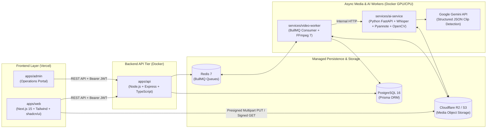

# ClipForge AI — AI-Powered Automatic Video Clipping SaaS

**ClipForge AI** is a production-grade SaaS platform that automatically transforms long-form videos (podcasts, interviews, webinars, lectures, and commentary) into contextually complete, high-retention short-form vertical videos (`9:16`, `1:1`, `16:9`) for **YouTube Shorts, Instagram Reels, and TikTok**.

Unlike basic timestamp splitters, ClipForge AI understands spoken conversation, speaker turn-taking, humor, emotional arcs, and educational frameworks using **Faster-Whisper**, **Pyannote.audio**, **Google Gemini**, **OpenCV**, and **FFmpeg**.

---

## Master Documentation Index (`docs/`)

All product, architectural, database, API, and engineering specifications are located in the [`docs/`](./docs/) directory:

| Document                            | Path                                                                     | Description                                                                                                                                                                                                                                             |
| :---------------------------------- | :----------------------------------------------------------------------- | :------------------------------------------------------------------------------------------------------------------------------------------------------------------------------------------------------------------------------------------------------ |
| **1. Product Requirements (PRD)**   | [`docs/PRD.md`](./docs/PRD.md)                                           | Product vision, personas, functional requirements (`A–I`), subscription tiers, credit rules, user stories, and MVP vs. V2 scope matrix.                                                                                                                 |
| **2. Technical Requirements (TRD)** | [`docs/TRD.md`](./docs/TRD.md)                                           | Polyglot stack specifications, technology justifications, distributed deployment topology, and core technical trade-offs.                                                                                                                               |
| **3. System Architecture**          | [`docs/SYSTEM_ARCHITECTURE.md`](./docs/SYSTEM_ARCHITECTURE.md)           | 10-component interaction matrix, Mermaid sequence & system diagrams, BullMQ retry/DLQ/cancellation flows, idempotency, and scratch disk cleanup.                                                                                                        |
| **4. Monorepo Folder Structure**    | [`docs/FOLDER_STRUCTURE.md`](./docs/FOLDER_STRUCTURE.md)                 | Complete directory tree across `apps/`, `services/`, `packages/`, and `infrastructure/` with file-level responsibilities.                                                                                                                               |
| **5. Database Schema & ER Design**  | [`docs/DATABASE_SCHEMA.md`](./docs/DATABASE_SCHEMA.md)                   | Normalized 17-table PostgreSQL design, Mermaid ER diagram, full Prisma schema (`schema.prisma`), indexing strategy, and data retention policies.                                                                                                        |
| **6. REST API Documentation**       | [`docs/API_DOCUMENTATION.md`](./docs/API_DOCUMENTATION.md)               | Complete `/api/v1/*` endpoint specifications, request/response JSON schemas, Zod validations, rate limits, and error codes.                                                                                                                             |
| **7. 15-Step AI Pipeline**          | [`docs/AI_PIPELINE.md`](./docs/AI_PIPELINE.md)                           | End-to-end AI workflow: `ffprobe`, `16kHz` WAV extraction, Whisper STT, Pyannote diarization, sliding-window Gemini analysis, multi-factor scoring, word boundary snapping, Temporal NMS (`IoU`), OpenCV speaker tracking, and `.ass` subtitle burn-in. |
| **8. Security & Scalability**       | [`docs/SECURITY_AND_SCALABILITY.md`](./docs/SECURITY_AND_SCALABILITY.md) | Argon2id + rotating JWT sessions, SSRF protection, presigned R2 URLs, FFmpeg sandboxing, tenant isolation, and horizontal GPU/CPU worker scaling.                                                                                                       |
| **9. 14-Phase Development Roadmap** | [`docs/DEVELOPMENT_ROADMAP.md`](./docs/DEVELOPMENT_ROADMAP.md)           | Dependency-ordered engineering execution plan from Phase 1 (Monorepo Setup) to Phase 14 (Production Launch).                                                                                                                                            |
| **10. Testing Strategy**            | [`docs/TESTING_STRATEGY.md`](./docs/TESTING_STRATEGY.md)                 | Unit, Integration (Testcontainers), API, Frontend, AI Recall Benchmark, FFmpeg SSIM, E2E (Playwright), Load (k6), and Security testing.                                                                                                                 |
| **11. Root Architecture Overview**  | [`ARCHITECTURE.md`](./ARCHITECTURE.md)                                   | Executive architectural blueprint and Golden Architectural Rules enforcement summary.                                                                                                                                                                   |
| **12. Environment Configuration**   | [`.env.example`](./.env.example)                                         | Complete template of all environment variables across Web, API, DB, Redis, AI Service, Worker, R2, and Razorpay/Stripe.                                                                                                                                 |

---

## Root Architecture Overview



### Core Architectural Principles

1. **Non-Blocking API Server**: `apps/api` never buffers video uploads or runs media/AI tasks in-process. Uploads stream directly from browser to **Cloudflare R2** via presigned multipart URLs; processing executes asynchronously via **Redis + BullMQ**.
2. **Polyglot Best-of-Breed Stack**: **TypeScript** (`Next.js`, `Express`, `Prisma`, `Zod`) powers the web application, API, and queue orchestration, while **Python** (`FastAPI`, `faster-whisper`, `pyannote.audio`, `google-genai`, `OpenCV`, `Pydantic`) powers speech, vision, and LLM pipelines.
3. **Deterministic Media Rendering**: **FFmpeg 7** with `libass` and `libx264` executes single-pass video cutting, smoothed `9:16` active-speaker cropping, and dynamic word-highlighted subtitle burn-in.
4. **Transparent Multi-Factor Scoring**: Candidate clips are scored across **Hook (`0–100`)**, **Engagement (`0–100`)**, and **Context Completeness (`0–100`)** with explicit AI selection rationale—never claiming guaranteed virality.

---

## Monorepo Workspace Layout

```text
clipforge-ai/
├── apps/
│   ├── web/                # Creator SaaS web app (Next.js 15, React 19, TanStack Query, Zustand)
│   ├── api/                # REST API server (Node.js, Express, TypeScript, BullMQ producer)
│   └── admin/              # Internal admin & queue monitoring dashboard
├── services/
│   ├── ai-service/         # Python FastAPI microservice (Whisper, Pyannote, Gemini, OpenCV)
│   └── video-worker/       # BullMQ worker executing FFmpeg pipelines and R2 media transfers
├── packages/
│   ├── database/           # Prisma schema, migrations, and shared PrismaClient
│   ├── shared-types/       # Shared TypeScript interfaces, enums, and DTO contracts
│   ├── validation/         # Shared Zod schemas for frontend forms, API bodies, and AI outputs
│   ├── config/             # Shared tsconfig, ESLint, and Tailwind presets
│   └── ui/                 # Shared React + shadcn/ui component library
├── infrastructure/         # Dockerfiles, Nginx configs, and operational scripts
└── docs/                   # Comprehensive engineering & product documentation
```

---

## Getting Started (Phase 1 Quickstart Blueprint)

Once Phase 1 scaffolding is initialized according to [`docs/DEVELOPMENT_ROADMAP.md`](./docs/DEVELOPMENT_ROADMAP.md):

```bash
# 1. Clone and install workspace dependencies
pnpm install

# 2. Copy master environment template
cp .env.example .env

# 3. Start local PostgreSQL 16, Redis 7, and MinIO (S3/R2 compatible storage)
docker compose up -d postgres redis minio

# 4. Run Prisma database migrations and seed subscription plans
pnpm --filter @clipforge/database prisma migrate dev
pnpm --filter @clipforge/database prisma db seed

# 5. Start all development servers (Web, API, Worker, and Python AI Service)
pnpm dev
```
