# AI Video Analysis & Clipping Pipeline: ClipForge AI

| Document Metadata | Details |
| :--- | :--- |
| **Services Involved** | `services/video-worker` (Node.js + FFmpeg 7) & `services/ai-service` (Python FastAPI) |
| **Core Models** | `faster-whisper (large-v3-turbo)`, `pyannote/speaker-diarization-3.1`, `gemini-2.5-pro` / `gemini-2.5-flash`, `MediaPipe BlazeFace + OpenCV` |

---

## 1. End-to-End 15-Step Pipeline Architecture

```mermaid
flowchart TD
    S1["Step 1: Validate & Stream Authorized Video Source\n(Verify Rights, SSRF Check, Download to /tmp/clipforge)"] --> S2
    S2["Step 2: Media Probing (ffprobe)\n(Extract Duration, Resolution, FPS, Audio/Video Codecs)"] --> S3
    S3["Step 3: Speech-Band Audio Extraction (FFmpeg)\n(16kHz, Mono, 16-bit PCM WAV)"] --> S4
    S4["Step 4: Word-Level Transcription (faster-whisper)\n(VAD Filtering + Word Start/End Timestamps)"] --> S5
    S5["Step 5: Speaker Diarization (pyannote.audio)\n(Align Speaker Turns with Whisper Words)"] --> S6
    S6["Step 6: Semantic Transcript Segmentation\n(Sentence Grouping + Sliding-Window Chunking)"] --> S7
    S7["Step 7: Multimodal/Semantic Analysis (Google Gemini)\n(Analyze Hooks, Humor, Emotion, Insights, Story Arcs)"] --> S8
    S8["Step 8: Candidate Clip Identification\n(Propose Start/End, Category, Title, Selection Reason)"] --> S9
    S9["Step 9: Multi-Factor Candidate Scoring\n(Hook, Engagement, Context Completeness, Overall Potential)"] --> S10
    S10["Step 10: Boundary Optimization & Word Snapping\n(Snap to Whisper Word Timestamps & Pause Boundaries)"] --> S11
    S11["Step 11: De-Duplication & Overlap Filtering\n(Temporal Non-Maximum Suppression via IoU < 0.15)"] --> S12
    S12["Step 12: Video Segment Extraction & Scene Analysis\n(Detect Camera Cuts & Track Active Speaker Faces via OpenCV)"] --> S13
    S13["Step 13: Smart Reframing & Dynamic .ass Subtitle Burn-In\n(Smoothed 9:16 Trajectory + Word-Highlighted Subtitles)"] --> S14
    S14["Step 14: Final MP4 Encoding & Thumbnail Generation\n(H.264 + AAC 1080p/720p + Sharpest Face Frame JPG)"] --> S15
    S15["Step 15: Cloud Object Upload & State Commit\n(Upload to R2, Commit Credits, Mark READY, Clean /tmp)"]
```



---

## 2. Detailed Step-by-Step Technical Specification

### Step 1: Validate and Access Authorized Video Source
- Verifies `VideoProject.rightsAttested === true`.
- If `sourceType === 'FILE_UPLOAD'`, streams the object from Cloudflare R2 to `/tmp/clipforge/jobs/{jobId}/source.mp4`.
- If `sourceType === 'AUTHORIZED_URL'`, validates the URL against the SSRF guard (resolving DNS and blocking private IPv4/IPv6 ranges), checks `Content-Type` (`video/*`) and `Content-Length` (`<= tier limit`), and streams to `/tmp/clipforge/jobs/{jobId}/source.mp4`.

### Step 2: Extract Technical Media Metadata (`ffprobe`)
Executes deterministic `ffprobe` inspection:
```bash
ffprobe -v quiet -print_format json -show_format -show_streams /tmp/clipforge/jobs/{jobId}/source.mp4
```
- Extracts `durationSeconds`, `width`, `height`, `fps` (parsed from `r_frame_rate`), `videoCodec`, and verifies that at least one audio stream exists.
- If `durationSeconds < 30` or `durationSeconds > tierMaxDuration`, throws `UnrecoverableError("VIDEO_DURATION_OUT_OF_BOUNDS")`.

### Step 3: Extract Speech-Optimized Audio via FFmpeg
Whisper and Pyannote operate internally on `16kHz` mono audio. Extracting a raw `16kHz` mono WAV reduces a 2 GB video into a ~115 MB audio file in seconds:
```bash
ffmpeg -y -i source.mp4 -vn -acodec pcm_s16le -ar 16000 -ac 1 audio_16k.wav
```

### Step 4: Generate Timestamped Transcript (`faster-whisper`)
`services/ai-service` processes `audio_16k.wav` using `faster-whisper` (`large-v3-turbo` on GPU with `float16`, or `int8` on CPU):
- **Configuration**: `word_timestamps=True`, `vad_filter=True`, `vad_parameters=dict(min_silence_duration_ms=400)`.
- Produces segments and exact word-level objects: `{"word": " Founders", "start": 12.34, "end": 12.78, "probability": 0.96}`.

### Step 5: Speaker Diarization (`pyannote.audio`)
- Runs `pyannote/speaker-diarization-3.1` on `audio_16k.wav` to produce speaker turn intervals `[(start, end, "SPEAKER_00"), ...]`.
- **Word-to-Speaker Alignment (`aligner.py`)**: Assigns each Whisper word to the speaker whose diarization turn has the maximum temporal overlap with `[word.start, word.end]`. Consecutive words from the same speaker are grouped into `TranscriptSegment` records.

### Step 6: Semantic Segmentation & Long-Video Chunking Strategy
Long videos (e.g., a 3-hour podcast = ~32,000 words) can suffer from "lost-in-the-middle" recall degradation if analyzed in a single pass without structure.
- **Sentence & Utterance Indexed Formatting**: Each utterance is formatted with millisecond-accurate timestamps and speaker tags:
  `[0412.40s - 0418.10s] [SPEAKER_00]: Ninety percent of micro-SaaS founders fail at distribution because they build in stealth for six months.`
- **Sliding-Window Chunking Strategy**:
  - Videos `<= 45 minutes`: Sent in a **single window** to Gemini (leverages full global context).
  - Videos `> 45 minutes`: Divided into **30-minute semantic windows** with a **5-minute overlap** (`0–30m`, `25–55m`, `50–80m`, etc.), snapping window boundaries to natural speaker turn pauses (`> 1.0s` silence). The 5-minute overlap guarantees that an engaging story straddling the 30-minute mark is never cut in half.

### Step 7 & Step 8: Semantic Analysis & Candidate Clip Detection (Google Gemini API)
For each transcript window, `services/ai-service` invokes Gemini (`gemini-2.5-pro` or `gemini-2.5-flash`) using **Native Structured Outputs** (`response_mime_type="application/json"`, `response_schema=GeminiClipAnalysisResponse`).

#### System Prompt (`services/ai-service/app/services/semantic_analysis/prompts.py`)
```text
You are an elite short-form video producer and narrative editor for YouTube Shorts, Instagram Reels, and TikTok.
Your task is to analyze a timestamped, speaker-diarized video transcript and extract the highest-potential standalone short-form clips.

STRICT EDITORIAL RULES:
1. SELF-CONTAINED CONTEXT: Every selected clip MUST make complete sense to a cold viewer who has never seen the full video. Never start a clip with unresolved pronouns ("That's why...", "As I said earlier...") or end mid-thought.
2. DURATION CONSTRAINTS: Every candidate clip MUST have a duration between {min_duration} seconds and {max_duration} seconds.
3. STRONG OPENING HOOK: The first 3 to 5 seconds of the clip must contain a compelling statement, question, contrarian insight, emotional hook, or humorous setup.
4. NATURAL CONCLUSION: The clip must end on a decisive punchline, takeaway, or resolved thought.
5. ARCHETYPE DIVERSITY: Identify moments across these categories:
   - HOOK: Contrarian or scroll-stopping opening claims
   - FUNNY: Genuinely humorous exchanges or witty stories
   - EDUCATIONAL: Step-by-step frameworks, tutorials, or actionable advice
   - EMOTIONAL: Vulnerable, intense, or deeply relatable human moments
   - STORYTELLING: Complete micro-stories with setup, conflict, and resolution
   - MOTIVATIONAL: High-energy inspirational takeaways
   - DISCUSSION: Sharp back-and-forth debate between multiple speakers
   - INSIGHT: Surprising facts, industry secrets, or mental models
6. HONEST SCORING: Evaluate estimated engagement potential objectively (0-100). Never claim guaranteed virality.
7. EXACT TIMESTAMPS: Use the exact start and end timestamps (in seconds) provided in the transcript markers.
```

### Step 9: Multi-Factor Candidate Scoring System
Each candidate is scored across three primary pillars and combined into a transparent composite score:
1. **`hookScore` (`0–100`)**: Evaluates the opening 3–5 seconds for curiosity gap, clarity, stakes, and pattern interruption.
2. **`engagementScore` (`0–100`)**: Evaluates pacing, information density, emotional resonance, humor, or narrative tension across the body of the clip, penalized if speech contains excessive filler or long dead air.
3. **`contextScore` (`0–100`)**: Evaluates standalone narrative completeness (setup → body → resolution) without requiring external context.
4. **`overallScore` (`0–100`)**: Calculated deterministically in `clip_scorer.py` to prevent LLM arithmetic drift:
   $$\text{OverallScore} = \text{round}(0.30 \times \text{HookScore} + 0.40 \times \text{EngagementScore} + 0.30 \times \text{ContextScore})$$

### Step 10: Boundary Optimization Using Word Timestamps
LLMs occasionally output rounded timestamps (e.g., `412.0s` instead of `412.40s`). `boundary_optimizer.py` refines every candidate:
1. **Start Boundary Snapping**: Finds the Whisper word nearest to `raw_start_time`. If that word is inside a sentence and the sentence begins within `3.0 seconds` prior, snaps `startTime` to the first word of that sentence minus a `120ms` pre-roll buffer (so the first consonant isn't clipped).
2. **End Boundary Snapping**: Finds the Whisper word nearest to `raw_end_time`, snaps to the end of the current terminal punctuation mark (`.`, `?`, `!`) within duration bounds, and adds a `200ms` post-roll audio tail buffer.

### Step 11: Duplicate & Overlapping Candidate Detection (Temporal NMS)
Because sliding windows overlap by 5 minutes (and Gemini may propose two variations of the same story), `boundary_optimizer.py` runs **Temporal Non-Maximum Suppression (NMS)**:
1. Sort all candidate clips across all windows by `overallScore DESC`.
2. For any two clips $A$ and $B$, compute Temporal Intersection over Union ($\text{IoU}$):
   $$\text{IoU}(A, B) = \frac{\max(0, \min(A_{\text{end}}, B_{\text{end}}) - \max(A_{\text{start}}, B_{\text{start}}))}{\max(A_{\text{end}}, B_{\text{end}}) - \min(A_{\text{start}}, B_{\text{start}})}$$
   Also compute Overlap Coefficient: $\frac{\text{Intersection}}{\min(\text{Duration}_A, \text{Duration}_B)}$.
3. If $\text{IoU} > 0.15$ or Overlap Coefficient $> 0.30$, discard the lower-scoring candidate.
4. Return the top `maxClipsToGen` candidates.

### Step 12: Video Segment Extraction & OpenCV Active Speaker Tracking
For each selected clip `[startTime, endTime]`:
1. **Shot Boundary Detection (`scene_detector.py`)**: Samples frames at `5 fps` within `[startTime, endTime]` and detects camera cuts using HSV histogram difference thresholds.
2. **Face Tracking (`face_tracker.py`)**:Within each continuous shot, detects face bounding boxes using MediaPipe BlazeFace / OpenCV DNN. When multiple faces appear, correlates lip motion variance with active speech segments.
3. **Smoothed Crop Trajectory (`crop_smoother.py`)**: To convert `16:9` (`1920x1080`) into `9:16` (`608x1080` crop window scaled to `1080x1920`), applies a **Deadzone + Exponential Moving Average (EMA)** filter. The virtual camera only pans if the speaker's face drifts outside the central 25% safe zone, preventing nauseating frame-by-frame jitter. If no face is present (e.g., code screen share), falls back to `BLUR_PAD` (full `16:9` centered over a blurred `9:16` background).

### Step 13 & Step 14: Dynamic `.ass` Subtitle Generation & Single-Pass FFmpeg Rendering
`services/video-worker` generates an Advanced SubStation Alpha (`.ass`) file grouping words into 3-word phrases (`wordsPerLine = 3`) with active-word highlight tags (`{\c&H15CCFA&}`) synchronized to millisecond word timestamps.

It then executes a single hardware/multi-threaded FFmpeg render pass:
```bash
ffmpeg -y -ss 412.280 -to 459.050 -i source.mp4 \
  -vf "crop=w=ih*9/16:h=ih:x='...',scale=1080:1920:flags=lanczos,ass=/tmp/clipforge/jobs/{jobId}/clip_1.ass" \
  -c:v libx264 -preset fast -crf 20 -pix_fmt yuv420p \
  -c:a aac -b:a 192k -ac 2 \
  -movflags +faststart \
  /tmp/clipforge/jobs/{jobId}/clip_1_1080p.mp4
```
Simultaneously, `thumbnail-generator.ts` samples frames from the first 5 seconds of the clip, computes the **Laplacian variance** (sharpness metric) on detected face regions, and exports the sharpest frame as `thumb_{clipId}.jpg`.

### Step 15: Upload Results & Update Project Status
- Uploads `clip_{clipId}.mp4` and `thumb_{clipId}.jpg` to Cloudflare R2.
- Creates `Export` records, updates `Clip.status = 'READY'`, commits held user credits (`UsageHistory.transactionType = 'COMMIT'`), updates `ProcessingJob.status = 'COMPLETED'`, and purges `/tmp/clipforge/jobs/{jobId}`.

---

## 3. Structured AI Output Schema & Example JSON

### 3.1 Pydantic Validation Schema (`services/ai-service/app/schemas/clip_schema.py`)
```python
from enum import Enum
from pydantic import BaseModel, Field, model_validator

class ClipCategoryEnum(str, Enum):
    HOOK = "HOOK"
    FUNNY = "FUNNY"
    EDUCATIONAL = "EDUCATIONAL"
    EMOTIONAL = "EMOTIONAL"
    STORYTELLING = "STORYTELLING"
    MOTIVATIONAL = "MOTIVATIONAL"
    DISCUSSION = "DISCUSSION"
    INSIGHT = "INSIGHT"

class CandidateScoreSchema(BaseModel):
    hook_score: int = Field(..., ge=0, le=100, description="Strength of opening 3-5s hook (0-100)")
    engagement_score: int = Field(..., ge=0, le=100, description="Pacing, humor, emotion, or insight density (0-100)")
    context_score: int = Field(..., ge=0, le=100, description="Standalone narrative completeness (0-100)")
    confidence: float = Field(default=0.85, ge=0.0, le=1.0)

class CandidateClipSchema(BaseModel):
    start_time: float = Field(..., ge=0.0, description="Clip start timestamp in seconds")
    end_time: float = Field(..., gt=0.0, description="Clip end timestamp in seconds")
    title: str = Field(..., min_length=5, max_length=120)
    description: str = Field(..., min_length=15, max_length=500)
    category: ClipCategoryEnum
    selection_reason: str = Field(..., min_length=20, max_length=400)
    scores: CandidateScoreSchema

    @model_validator(mode="after")
    def validate_duration(self) -> "CandidateClipSchema":
        if self.end_time <= self.start_time:
            raise ValueError("end_time must be strictly greater than start_time")
        return self

class GeminiClipAnalysisResponse(BaseModel):
    candidates: list[CandidateClipSchema]
```

### 3.2 Shared TypeScript Zod Schema (`packages/validation/src/ai-clip.schema.ts`)
```typescript
import { z } from "zod";

export const aiClipCandidateSchema = z.object({
  startTime: z.number().nonnegative(),
  endTime: z.number().positive(),
  duration: z.number().min(10).max(180),
  title: z.string().min(5).max(120),
  description: z.string().min(15).max(500),
  category: z.enum([
    "HOOK", "FUNNY", "EDUCATIONAL", "EMOTIONAL",
    "STORYTELLING", "MOTIVATIONAL", "DISCUSSION", "INSIGHT"
  ]),
  selectionReason: z.string().min(20).max(400),
  scores: z.object({
    hookScore: z.number().int().min(0).max(100),
    engagementScore: z.number().int().min(0).max(100),
    contextScore: z.number().int().min(0).max(100),
    overallScore: z.number().int().min(0).max(100),
    confidence: z.number().min(0).max(1)
  })
}).refine((c) => c.endTime > c.startTime, {
  message: "endTime must be greater than startTime"
});
```

### 3.3 Example Validated JSON Output from AI Service
```json
{
  "candidates": [
    {
      "startTime": 412.40,
      "endTime": 458.85,
      "duration": 46.45,
      "title": "Why 90% of Micro-SaaS Founders Fail at Distribution",
      "description": "Rohan explains why building in stealth for six months kills early-stage SaaS products and shares a 3-step cold outreach framework.",
      "category": "EDUCATIONAL",
      "selectionReason": "Opens with a bold contrarian statistic in the first 3.2 seconds, delivers a concrete 3-step actionable framework, and concludes with a memorable one-line takeaway.",
      "scores": {
        "hookScore": 94,
        "engagementScore": 89,
        "contextScore": 92,
        "overallScore": 91,
        "confidence": 0.93
      }
    }
  ]
}
```

---

## 4. Token & Cost Optimization Strategy

1. **Compact Transcript Representation**: Do not send word-by-word JSON objects (`{"word": "the", "start": 1.1, "end": 1.2}`) to Gemini—that inflates token count by 6x. Send utterance-level lines (`[0412.40s - 0418.10s] [SPEAKER_00]: Text...`) to Gemini, and perform exact word-level snapping locally in Python (`boundary_optimizer.py`) using the cached Whisper word array.
2. **Tiered Gemini Model Selection**: Use `gemini-2.5-flash` for initial semantic window scanning and candidate generation, and optionally use `gemini-2.5-pro` for final candidate ranking and refinement. A 60-minute podcast transcript (~9,000 words = ~12,000 input tokens) costs less than `$0.01` per video in Gemini API tokens.
3. **Transcript Caching**: Persist the Whisper `Transcript` and `TranscriptSegment` rows immediately in PostgreSQL before calling Gemini. If a Gemini call fails or the user requests clip regeneration with different duration settings (`15–30s` instead of `30–60s`), the pipeline reuses the stored transcript without re-running Whisper or Pyannote.

