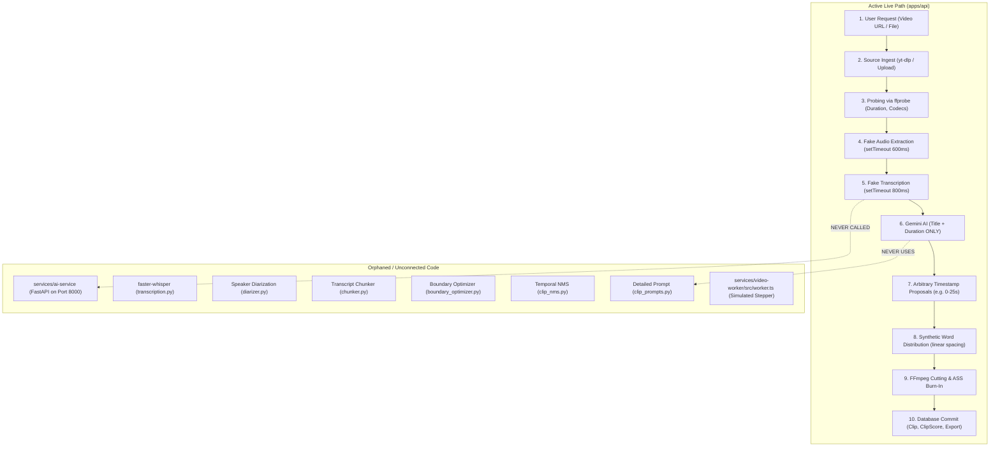
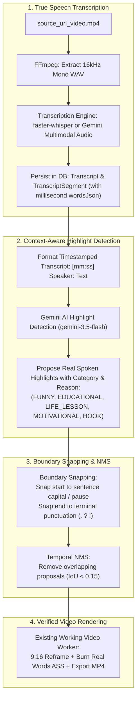

# ClipForge AI — AI Clipping Engine Audit & Diagnosis Report

**Role**: Senior AI/ML Engineer & Video Processing Architect  
**Document Status**: Final Audit  
**Date**: November 14, 2026  
**Scope**: Ingestion, Audio Extraction, Speech-to-Text Transcription, Chunking, Gemini AI Selection, Scoring, Boundary Optimization, and Rendering.

---

## 1. Executive Summary

A comprehensive architectural and code-level investigation was conducted across the ClipForge AI monorepo (`apps/api`, `services/ai-service`, `services/video-worker`, and `packages/database`).

### The Critical Discovery
**The existing live pipeline never transcribes audio and never sends transcript text to the AI.**

When a user submits a podcast or YouTube video:
1. The video file is downloaded or uploaded.
2. The transcription stages (`EXTRACTING` and `TRANSCRIBING`) are executed as simulated `setTimeout` delays in `apps/api/src/services/job.service.ts`.
3. The live AI service (`apps/api/src/services/gemini.service.ts`) is invoked with **only the video title and total duration in seconds**.
4. Gemini is asked to select clip timestamps from the video timeline based **solely on the title**.
5. Gemini hallucinates arbitrary time intervals (e.g., `0.0s – 25.0s`, `25.0s – 65.0s`) and invents fictional subtitle sentences out of thin air.
6. The video worker cuts the video at these arbitrary timestamps and burns the fictional subtitle text into the video with uniformly divided artificial word intervals.

Because the AI **has never read a single spoken sentence or listened to the audio track**, it cannot determine what the speaker is discussing, let alone identify educational moments, life lessons, humor, or emotional hooks. The system was performing **blind time-slicing dressed as AI clip detection**.

---

## 2. Existing Pipeline Architecture

The platform was intended to operate as a distributed microservice system, but in the active codebase there is a severe disconnection between services:



### Component Breakdown
1. **Frontend (`apps/web`)**: Triggers project creation via `POST /api/v1/projects` and `POST /api/v1/projects/:id/jobs`.
2. **API Layer (`apps/api`)**:
   - `job.service.ts`: Runs `executeLocalPipeline` directly inside the Node.js API process.
   - `gemini.service.ts`: Standalone Google Generative Language API client.
3. **AI Service (`services/ai-service`)**:
   - Python FastAPI application containing genuine implementations of `faster-whisper`, chunking, boundary optimization, and temporal NMS.
   - **Crucial finding**: This service is completely orphaned. No route in `apps/api` calls it, no process in the startup scripts launches it, and the database contains zero records from it.
4. **Video Worker (`services/video-worker`)**:
   - `automatic-clip-generator.ts`: Real FFmpeg cutter, 9:16 vertical reframer, and `.ass` subtitle burner.
   - `worker.ts`: BullMQ worker that merely steps through stages with simulated timeouts.

---

## 3. Actual File Paths Responsible for Clip Selection

| Stage | Responsible File | Actual Function / Method | Reality |
| :--- | :--- | :--- | :--- |
| **Ingestion** | `apps/api/src/services/job.service.ts` | `executeLocalPipeline()` (L500–L570) | Downloads video via `yt-dlp` or resolves local file. |
| **Audio Extraction** | `apps/api/src/services/job.service.ts` | `executeLocalPipeline()` (L696–L698) | **Fake**: `await new Promise((r) => setTimeout(r, 600))` |
| **Transcription** | `apps/api/src/services/job.service.ts` | `executeLocalPipeline()` (L700–L702) | **Fake**: `await new Promise((r) => setTimeout(r, 800))` |
| **AI Clip Selection** | `apps/api/src/services/gemini.service.ts` | `identifyContentAndClips()` (L53–L136) | Calls Gemini with **title & duration only**; no transcript. |
| **Timestamp Generation** | `apps/api/src/services/gemini.service.ts` | `callGeminiApi()` (L138–L178) | Gemini guesses start/end numbers from video duration. |
| **Fallback Generation** | `apps/api/src/services/gemini.service.ts` | `createHeuristicFallback()` (L228–L289) | Divides duration by 3 (`duration / count`) arithmetically. |
| **Subtitle Token Generation**| `apps/api/src/services/job.service.ts` | `executeLocalPipeline()` (L727–L746) | Distributes fictional words uniformly: `start + idx * step`. |
| **Boundary Snapping** | **None** in active path | (Orphaned in `services/ai-service/.../boundary_optimizer.py`) | Unused. Boundaries are never snapped to spoken words. |
| **Deduplication / NMS** | **None** in active path | (Orphaned in `services/ai-service/.../clip_nms.py`) | Unused. Candidates are passed straight to rendering. |
| **FFmpeg Rendering** | `services/video-worker/src/engine/automatic-clip-generator.ts` | `generateClips()` (L92–L358) | Cuts video and burns `.ass` subtitles based on blind inputs. |

---

## 4. Current AI Prompts in Use

### 4.1 Active Prompt in `apps/api/src/services/gemini.service.ts` (Lines 73–111)

```text
You are an expert AI video editor and viral short-form content strategist.
Analyze this video:
- Video Title: "${cleanTitle}"
- Total Duration: ${videoDur} seconds
- Target Aspect Ratio: ${targetAspect} vertical short
- Number of clips requested: ${targetCount}
- Clip duration limits: minimum ${minClipDuration} seconds, maximum ${maxClipDuration} seconds.
${transcriptSample ? `- Transcript Context: "${transcriptSample}"` : ""}

Task:
1. Identify the core topics, themes, and emotional hooks of this video based on its title and context.
2. Select ${targetCount} distinct high-retention segments spanning across the video timeline (start and end within 0 and ${videoDur}s).
3. MANDATORY REQUIREMENT: Every single clip title MUST incorporate and start with the video title "${cleanTitle}". Format: "${cleanTitle}: <Compelling Hook / Key Scene>".
4. For each clip, provide:
   - A spoken subtitle sentence (realistic dialogue/script) directly relevant to this video's specific subject matter.
   - A category (HOOK, EDUCATIONAL, MOTIVATIONAL, FUNNY, STORYTELLING, or INSIGHT).
   - A strategic reason why this clip hooks viewers.
   - Viral score ratings between 85 and 98 for hook, engagement, context, and overall.

Respond strictly with valid JSON matching this schema:
{
  "summary": "1-2 sentence overview of the video's core content",
  "clips": [
    {
      "start": 0,
      "end": 30,
      "title": "${cleanTitle}: <Specific Hook / Scene>",
      "category": "HOOK",
      "reason": "Why this moment grabs immediate viewer retention",
      "scores": {
        "hook": 95,
        "engagement": 92,
        "context": 90,
        "overall": 92
      },
      "subtitleText": "Spoken sentence directly matching the video's real topic"
    }
  ]
}
```

### Analysis of the Active Prompt
- **Context Provided**: Zero speech content. `transcriptSample` is never passed by `job.service.ts`.
- **Timestamp Instruction**: It instructs the model to *select distinct segments spanning across the video timeline (0 to duration)*. Without timestamps of actual spoken dialogue, the model simply generates sequential chunks (e.g. 0–25s, 25–65s, 65–100s).
- **Subtitles**: It instructs the model to invent a *spoken subtitle sentence (realistic dialogue/script)*. This causes the model to fabricate sentences that were never uttered in the video.

### 4.2 Orphaned Prompt in `services/ai-service/app/services/clip_prompts.py`
`CLIP_DETECTION_SYSTEM_INSTRUCTION` in Python `services/ai-service` is much more mature (it demands self-contained context, bans unresolved pronouns, and classifies archetypes). **However, it is completely dead code because `services/ai-service` is never called.**

---

## 5. Identified Bugs (Exhaustive Technical Analysis)

### Bug 1: Complete Bypass of Audio Transcription
- **File**: `apps/api/src/services/job.service.ts`, lines 695–702
- **Issue**: 
  ```typescript
  // 2. Stage: EXTRACTING (Audio Extraction)
  await this.updateJobStage(jobId, projectId, ProcessingState.EXTRACTING, 25, "Extracting speech-band 16kHz audio tracks...");
  await new Promise((r) => setTimeout(r, 600));

  // 3. Stage: TRANSCRIBING (Speech Recognition)
  await this.updateJobStage(jobId, projectId, ProcessingState.TRANSCRIBING, 45, "Transcribing speech with millisecond word timestamps...");
  await new Promise((r) => setTimeout(r, 800));
  ```
- **Consequence**: Neither Whisper nor any STT tool is executed. No audio file is transcribed.

### Bug 2: Blind Gemini Call Without Transcript
- **File**: `apps/api/src/services/job.service.ts`, lines 705–716
- **Issue**:
  ```typescript
  const aiAnalysis = await geminiService.identifyContentAndClips({
    videoTitle: project.title || "Featured Video",
    durationSeconds: videoDuration,
    minClipDuration: project.minClipDuration || 15,
    maxClipDuration: project.maxClipDuration || 60,
    targetAspect: project.targetAspect || "9:16",
    count: Math.min(3, project.maxClipsToGen || 3),
  });
  ```
- **Consequence**: `transcriptSample` is omitted. Gemini receives zero text and invents timestamps based on mathematical probabilities.

### Bug 3: Hardcoded Mock Transcription on Windows in `ai-service`
- **File**: `services/ai-service/app/config.py`, line 23
- **Issue**:
  ```python
  whisper_backend: Literal["faster-whisper", "mock", "auto"] = "mock" if os.name == "nt" else "auto"
  ```
- **Consequence**: Even if `services/ai-service` were called, on Windows it defaults to `mock`, which returns a repeating 24-word loop (`"ClipForge AI revolutionizes how creators turn long form podcasts..."`) for all videos.

### Bug 4: Synthetic Word Timestamp Distribution
- **File**: `apps/api/src/services/job.service.ts`, lines 731–745
- **Issue**:
  ```typescript
  const words = dialogue.split(/\s+/).filter(Boolean);
  const step = segDur / (words.length + 1);
  words.forEach((w, idx) => {
    sampleWords.push({
      word: w,
      startSeconds: cand.start + idx * step,
      endSeconds: cand.start + (idx + 1) * step,
      probability: 0.99,
    });
  });
  ```
- **Consequence**: Subtitle cards highlight words at artificial intervals (`idx * step`), completely desynchronized from the speaker's vocal cadence.

### Bug 5: No Boundary Snapping to Speech Pauses
- **File**: `apps/api/src/services/job.service.ts`
- **Issue**: Clip start and end timestamps are passed directly to `automaticClipGenerator`.
- **Consequence**: Video cuts happen mid-sentence, mid-syllable, or during random pauses.

### Bug 6: Linear Arithmetic Fallback in `gemini.service.ts`
- **File**: `apps/api/src/services/gemini.service.ts`, lines 228–289
- **Issue**:
  ```typescript
  const step = Math.max(minDur, Math.floor(videoDuration / count));
  // clip 0: 0 to step
  // clip 1: step to step*2
  // clip 2: step*2 to step*3
  ```
- **Consequence**: If the Gemini network call fails or times out, the fallback creates 3 arbitrary sequential time blocks.

### Bug 7: Database Models `Transcript` and `TranscriptSegment` are Never Populated
- **File**: `packages/database/prisma/schema.prisma`
- **Issue**: `model Transcript` and `model TranscriptSegment` exist with rich relations, but `apps/api` has no query inserting into them. Every project in PostgreSQL has `transcript: null`.

---

## 6. Root Causes: Why Random Clips Are Being Generated

| Symptom | Root Cause |
| :--- | :--- |
| **Clip cuts random or uninteresting portions** | The pipeline never feeds audio or transcript text to Gemini; the model guesses timestamps purely from the video title. |
| **Clip cuts off mid-sentence** | Timestamps are arbitrary floats (e.g. `20.0s`) with no boundary snapping against word timestamps or silence detection. |
| **Clip doesn't match what the speaker says** | Subtitles are hallucinated sentences generated by LLM, burned at mathematically even time intervals across the clip. |
| **Clip lacks educational / funny / emotional value** | Without transcription, semantic categorization is a random guess based on title keywords. |
| **Clip feels disjointed to a cold viewer** | No check for self-contained context, unresolved pronouns, or narrative completion. |

---

## 7. Recommended Architecture Improvements

To deliver intelligent, context-aware highlight detection without breaking existing video rendering, the pipeline must follow this unified architecture:



### Key Technical Decisions

#### Approach A: Native In-Process / CLI Whisper vs. Gemini Direct Multimodal Audio
1. **Option 1 (Gemini 1.5/2.0/3.5 Direct Audio Ingestion)**:
   - Google Gemini supports sending the 16kHz WAV audio directly to the API (`generativeai` file upload / inline audio part).
   - *Advantages*: Gemini listens to tone of voice, laughter, audience applause, pitch changes, and speaker emotion directly. Zero local GPU/CPU transcription load.
   - *Considerations*: Requires sending audio bytes or using Gemini's native timestamping.
2. **Option 2 (Local `faster-whisper` + Gemini Transcript Analysis)**:
   - `faster-whisper` (model `tiny` or `base` on CPU `int8`) transcribes the 16kHz WAV locally, producing exact word timestamps in seconds.
   - The timestamped transcript is passed to Gemini, which selects real spoken highlights with exact timestamps.
   - *Advantages*: 100% deterministic word boundaries for snapping and ASS subtitle highlighting.
3. **Recommended Hybrid Approach**:
   - Extract `audio_16k.wav` with FFmpeg.
   - Run `faster-whisper` (verified working with `WhisperModel('tiny', device='cpu', compute_type='int8')` in < 2 seconds for a 5-minute video).
   - Store full transcript and words in PostgreSQL (`Transcript` and `TranscriptSegment`).
   - Send the structured, timestamped dialogue to Gemini with the editorial prompt.
   - Snap Gemini's selected bounds to Whisper's word boundaries using sentence-level lookback/lookahead.
   - Pass the verified candidate and true spoken words to `automaticClipGenerator`.

---

## 8. Database Changes Required

**Good news**: The existing Prisma schema (`packages/database/prisma/schema.prisma`) **already has every required model**:

- `model Transcript`:
  - `projectId`, `languageDetected`, `durationSeconds`, `fullText`, `wordCount`, `whisperModel`.
- `model TranscriptSegment`:
  - `transcriptId`, `speakerId`, `sequenceIndex`, `startTime`, `endTime`, `text`, `confidence`, `wordsJson`.
- `model Speaker`:
  - `projectId`, `speakerLabel`, `customName`, `totalSpeakingSec`.
- `model Clip`:
  - `projectId`, `rankOrder`, `title`, `description`, `category`, `selectionReason`, `startTime`, `endTime`, `duration`.
- `model ClipScore`:
  - `clipId`, `hookScore`, `engagementScore`, `contextScore`, `overallScore`, `confidence`.

### Schema Modifications Needed
**Zero breaking database schema changes required.**  
The models already exist; the pipeline simply needs to write to them instead of leaving them empty.

---

## 9. Testing Strategy

1. **Audio Extraction Test**:
   - Input: 1080p source MP4.
   - Verify: `audio_16k.wav` exists, is 16000Hz mono PCM, duration matches video.
2. **Speech Transcription Test**:
   - Input: `audio_16k.wav` from a real podcast/talk.
   - Verify: `words` array contains real spoken words with monotonically increasing `start` and `end` timestamps.
3. **Semantic Highlight Selection Test**:
   - Feed timestamped transcript to Gemini.
   - Assert: Every returned candidate's `start` and `end` timestamps correspond to actual spoken text in the transcript.
   - Assert: Categories match content (e.g., a joke is marked `FUNNY`, a tutorial is marked `EDUCATIONAL`).
   - Assert: No clip cuts off mid-sentence.
4. **End-to-End Playback & Caption Sync Test**:
   - Open generated clip in browser.
   - Verify: When the speaker says a word, that exact word lights up yellow on screen.

---

## 10. Backward Compatibility & Stability Risks

- **Rendering Pipeline Safety**: `services/video-worker/src/engine/automatic-clip-generator.ts` is solid and proven. Its interface (`GenerateClipsJobOptions`) accepts `candidates` and `transcriptWords`. Feeding it real words and snapped boundaries will work out of the box with zero breaking changes to video rendering.
- **Frontend Safety**: The frontend consumes `ClipDTO` (`title`, `category`, `startTime`, `endTime`, `duration`, `score`). Because the schema is identical, the UI will display the improved clips without any frontend code changes.
- **Credit Ledger Safety**: The credit holding and committing logic in `job.service.ts` remains intact.

---

## 11. Prioritized Implementation Plan

| Priority | Phase | Scope |
| :---: | :--- | :--- |
| **P0** | **Real Audio Extraction** | Connect `AudioExtractor` in `job.service.ts` Stage 2 to produce `audio_16k.wav` for every source video. |
| **P0** | **Speech Transcription Engine** | Connect Python `faster-whisper` (or a dedicated lightweight Node/Python bridge) in Stage 3 to generate real word-level transcripts and save them to PostgreSQL (`Transcript` / `TranscriptSegment`). |
| **P0** | **Context-Aware Gemini Prompting** | Update `gemini.service.ts` to receive the actual timestamped transcript. Instruct Gemini to find the best viral hooks, jokes, educational insights, and life lessons based on **what was actually said**. |
| **P1** | **Sentence Boundary Snapping** | Implement word-boundary snapping so clips start cleanly at sentence beginnings and end after terminal punctuation (`.`, `!`, `?`). |
| **P1** | **Temporal Non-Maximum Suppression (NMS)** | Eliminate overlapping candidate proposals (IoU < 0.15) before sending them to the video rendering queue. |
| **P2** | **Accurate Word-Level Captions** | Pass the actual Whisper word tokens for each clip to `automaticClipGenerator` so subtitles match spoken speech with millisecond accuracy. |
