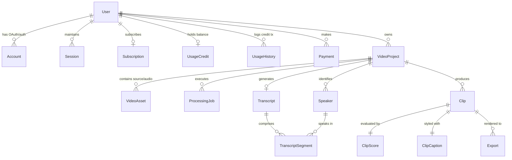

# Database Schema & Data Architecture: ClipForge AI

| Document Metadata | Details |
| :--- | :--- |
| **Database Engine** | PostgreSQL 16.x |
| **ORM** | Prisma 6.x (`packages/database/prisma/schema.prisma`) |
| **Primary Key Strategy** | UUID v7 / CUID2 (String/UUID) for public safety and B-Tree locality |
| **Timestamp Strategy** | `TIMESTAMPTZ` (UTC) across all tables |

---

## 1. Entity-Relationship (ER) Diagram



---

## 2. Detailed Table Specifications

### 2.1 Identity & Access Management

#### `User`
Stores core user identity, role, and account status.
| Column | Type | Constraints | Description |
| :--- | :--- | :--- | :--- |
| `id` | `UUID` | `PK`, `DEFAULT gen_random_uuid()` | Unique user identifier |
| `email` | `VARCHAR(255)` | `UNIQUE`, `NOT NULL` | Normalized lowercase email address |
| `passwordHash` | `VARCHAR(255)` | `NULLABLE` | Argon2id password hash (nullable for future OAuth-only users) |
| `fullName` | `VARCHAR(120)` | `NOT NULL` | Display name |
| `avatarUrl` | `TEXT` | `NULLABLE` | Profile avatar URL |
| `role` | `UserRole` | `NOT NULL`, `DEFAULT 'USER'` | `USER`, `ADMIN` |
| `emailVerifiedAt`| `TIMESTAMPTZ` | `NULLABLE` | Timestamp when email verification succeeded |
| `isActive` | `BOOLEAN` | `NOT NULL`, `DEFAULT true` | Soft-ban / deactivation flag |
| `createdAt` | `TIMESTAMPTZ` | `NOT NULL`, `DEFAULT now()` | Account creation time |
| `updatedAt` | `TIMESTAMPTZ` | `NOT NULL` | Last profile update time |

#### `Account`
Future-ready OAuth provider linkage (Google OAuth 2.0, etc.).
| Column | Type | Constraints | Description |
| :--- | :--- | :--- | :--- |
| `id` | `UUID` | `PK` | Unique record ID |
| `userId` | `UUID` | `FK -> User.id (CASCADE)`, `NOT NULL` | Owning user |
| `provider` | `VARCHAR(50)` | `NOT NULL` | e.g., `credentials`, `google` |
| `providerAccountId`| `VARCHAR(255)` | `NOT NULL` | External sub/ID from provider |
| `accessToken` | `TEXT` | `NULLABLE` | Encrypted OAuth access token |
| `refreshToken` | `TEXT` | `NULLABLE` | Encrypted OAuth refresh token |
| `expiresAt` | `INTEGER` | `NULLABLE` | Token expiry epoch |
| `createdAt` | `TIMESTAMPTZ` | `NOT NULL`, `DEFAULT now()` | Linked timestamp |
*Unique Constraint*: `UNIQUE(provider, providerAccountId)`

#### `Session`
Tracks active refresh token sessions for instant revocation and security auditing.
| Column | Type | Constraints | Description |
| :--- | :--- | :--- | :--- |
| `id` | `UUID` | `PK` | Session ID (embedded in refresh JWT `jti`) |
| `userId` | `UUID` | `FK -> User.id (CASCADE)`, `NOT NULL` | Authenticated user |
| `refreshTokenHash`| `VARCHAR(255)` | `UNIQUE`, `NOT NULL` | SHA-256 hash of active refresh token |
| `userAgent` | `TEXT` | `NULLABLE` | Browser/device string |
| `ipAddress` | `VARCHAR(45)` | `NULLABLE` | IPv4 or IPv6 address |
| `expiresAt` | `TIMESTAMPTZ` | `NOT NULL` | Session expiration time |
| `revokedAt` | `TIMESTAMPTZ` | `NULLABLE` | Set on logout or password reset |
| `createdAt` | `TIMESTAMPTZ` | `NOT NULL`, `DEFAULT now()` | Login timestamp |

---

### 2.2 Billing, Subscriptions & Credit Ledger

#### `Subscription`
Tracks the user's current plan tier and billing cycle.
| Column | Type | Constraints | Description |
| :--- | :--- | :--- | :--- |
| `id` | `UUID` | `PK` | Subscription ID |
| `userId` | `UUID` | `FK -> User.id (CASCADE)`, `UNIQUE` | One active subscription record per user |
| `planTier` | `PlanTier` | `NOT NULL`, `DEFAULT 'FREE'` | `FREE`, `STARTER`, `PRO`, `BUSINESS` |
| `status` | `SubStatus` | `NOT NULL`, `DEFAULT 'ACTIVE'` | `ACTIVE`, `PAST_DUE`, `CANCELLED`, `EXPIRED` |
| `provider` | `PaymentProvider`| `NOT NULL`, `DEFAULT 'INTERNAL'` | `INTERNAL`, `RAZORPAY`, `STRIPE` |
| `providerSubId` | `VARCHAR(255)` | `UNIQUE`, `NULLABLE` | External Razorpay/Stripe subscription ID |
| `providerCustomerId`| `VARCHAR(255)` | `NULLABLE` | External customer ID |
| `currentPeriodStart`| `TIMESTAMPTZ` | `NOT NULL` | Start of current monthly cycle |
| `currentPeriodEnd` | `TIMESTAMPTZ` | `NOT NULL` | End/renewal date of current cycle |
| `cancelAtPeriodEnd`| `BOOLEAN` | `NOT NULL`, `DEFAULT false` | Whether auto-renew is disabled |
| `createdAt` | `TIMESTAMPTZ` | `NOT NULL`, `DEFAULT now()` | Created timestamp |
| `updatedAt` | `TIMESTAMPTZ` | `NOT NULL` | Updated timestamp |

#### `UsageCredit`
Real-time credit wallet for source video processing minutes.
| Column | Type | Constraints | Description |
| :--- | :--- | :--- | :--- |
| `id` | `UUID` | `PK` | Wallet ID |
| `userId` | `UUID` | `FK -> User.id (CASCADE)`, `UNIQUE` | Owning user |
| `totalAllocated` | `INTEGER` | `NOT NULL`, `DEFAULT 60` | Credits granted in current cycle (minutes) |
| `usedCredits` | `INTEGER` | `NOT NULL`, `DEFAULT 0` | Permanently consumed credits in cycle |
| `heldCredits` | `INTEGER` | `NOT NULL`, `DEFAULT 0` | Credits currently reserved by in-flight jobs |
| `bonusCredits` | `INTEGER` | `NOT NULL`, `DEFAULT 0` | Non-expiring top-up/promotional credits |
| `resetAt` | `TIMESTAMPTZ` | `NOT NULL` | Next scheduled credit reset timestamp |
| `updatedAt` | `TIMESTAMPTZ` | `NOT NULL` | Last balance modification |
*Invariant Check*: `(totalAllocated + bonusCredits - usedCredits - heldCredits) >= 0`

#### `UsageHistory`
Immutable audit ledger of every credit reservation, deduction, refund, or grant.
| Column | Type | Constraints | Description |
| :--- | :--- | :--- | :--- |
| `id` | `UUID` | `PK` | Ledger entry ID |
| `userId` | `UUID` | `FK -> User.id (CASCADE)`, `NOT NULL` | User whose balance changed |
| `projectId` | `UUID` | `FK -> VideoProject.id (SET NULL)`, `NULLABLE`| Associated project |
| `jobId` | `UUID` | `FK -> ProcessingJob.id (SET NULL)`, `NULLABLE`| Associated processing job |
| `transactionType`| `CreditTxType` | `NOT NULL` | `CYCLE_GRANT`, `HOLD`, `COMMIT`, `REFUND`, `ADMIN_ADJUST` |
| `amount` | `INTEGER` | `NOT NULL` | Credit delta (minutes) |
| `balanceAfter` | `INTEGER` | `NOT NULL` | Available balance snapshot after transaction |
| `description` | `VARCHAR(255)` | `NOT NULL` | Human-readable note |
| `createdAt` | `TIMESTAMPTZ` | `NOT NULL`, `DEFAULT now()` | Transaction timestamp |

#### `Payment`
Records all financial transactions and webhook events from Razorpay/Stripe.
| Column | Type | Constraints | Description |
| :--- | :--- | :--- | :--- |
| `id` | `UUID` | `PK` | Internal payment ID |
| `userId` | `UUID` | `FK -> User.id (RESTRICT)`, `NOT NULL` | Paying user |
| `subscriptionId` | `UUID` | `FK -> Subscription.id (SET NULL)`, `NULLABLE` | Linked subscription |
| `provider` | `PaymentProvider`| `NOT NULL` | `RAZORPAY`, `STRIPE` |
| `providerOrderId`| `VARCHAR(255)` | `UNIQUE`, `NOT NULL` | Razorpay `order_id` or Stripe `payment_intent` |
| `providerPaymentId`| `VARCHAR(255)`| `UNIQUE`, `NULLABLE` | Razorpay `payment_id` upon capture |
| `amountSubunits` | `INTEGER` | `NOT NULL` | Amount in smallest currency unit (paise / cents) |
| `currency` | `VARCHAR(3)` | `NOT NULL`, `DEFAULT 'INR'` | ISO 4217 currency code (`INR`, `USD`) |
| `status` | `PaymentStatus` | `NOT NULL` | `CREATED`, `AUTHORIZED`, `CAPTURED`, `FAILED`, `REFUNDED` |
| `receiptUrl` | `TEXT` | `NULLABLE` | Invoice/receipt URL |
| `rawWebhookPayload`| `JSONB` | `NULLABLE` | Sanitized webhook audit payload |
| `createdAt` | `TIMESTAMPTZ` | `NOT NULL`, `DEFAULT now()` | Payment initiation time |
| `updatedAt` | `TIMESTAMPTZ` | `NOT NULL` | Last status transition |

---

### 2.3 Video Projects, Ingestion & Background Jobs

#### `VideoProject`
Aggregate root for a single uploaded or linked long-form video.
| Column | Type | Constraints | Description |
| :--- | :--- | :--- | :--- |
| `id` | `UUID` | `PK` | Project ID |
| `userId` | `UUID` | `FK -> User.id (CASCADE)`, `NOT NULL` | Project owner |
| `title` | `VARCHAR(255)` | `NOT NULL` | Project title (defaults to filename) |
| `sourceType` | `VideoSourceType`| `NOT NULL` | `FILE_UPLOAD`, `AUTHORIZED_URL` |
| `sourceUrl` | `TEXT` | `NULLABLE` | Original URL if `AUTHORIZED_URL` |
| `rightsAttested` | `BOOLEAN` | `NOT NULL`, `DEFAULT false` | User confirmed content ownership/permission |
| `status` | `ProjectStatus` | `NOT NULL`, `DEFAULT 'DRAFT'` | `DRAFT`, `UPLOADED`, `QUEUED`, `PROCESSING`, `COMPLETED`, `FAILED`, `EXPIRED` |
| `language` | `VARCHAR(10)` | `NOT NULL`, `DEFAULT 'en'` | ISO 639-1 source language code |
| `targetAspect` | `AspectRatio` | `NOT NULL`, `DEFAULT 'RATIO_9_16'`| `RATIO_9_16`, `RATIO_16_9`, `RATIO_1_1` |
| `minClipDuration`| `INTEGER` | `NOT NULL`, `DEFAULT 15` | Preferred min clip length (seconds) |
| `maxClipDuration`| `INTEGER` | `NOT NULL`, `DEFAULT 60` | Preferred max clip length (seconds) |
| `maxClipsToGen` | `INTEGER` | `NOT NULL`, `DEFAULT 10` | Max candidate clips to generate |
| `expiresAt` | `TIMESTAMPTZ` | `NOT NULL` | Storage retention expiry based on tier |
| `deletedAt` | `TIMESTAMPTZ` | `NULLABLE` | Soft-delete timestamp |
| `createdAt` | `TIMESTAMPTZ` | `NOT NULL`, `DEFAULT now()` | Creation time |
| `updatedAt` | `TIMESTAMPTZ` | `NOT NULL` | Last update time |

#### `VideoAsset`
Represents physical media files stored in Cloudflare R2 / S3 (raw video, extracted 16kHz WAV).
| Column | Type | Constraints | Description |
| :--- | :--- | :--- | :--- |
| `id` | `UUID` | `PK` | Asset ID |
| `projectId` | `UUID` | `FK -> VideoProject.id (CASCADE)`, `NOT NULL`| Parent project |
| `assetKind` | `AssetKind` | `NOT NULL` | `SOURCE_VIDEO`, `EXTRACTED_AUDIO` |
| `storageBucket` | `VARCHAR(120)` | `NOT NULL` | R2/S3 bucket name |
| `storageKey` | `TEXT` | `UNIQUE`, `NOT NULL` | Object key path in bucket |
| `uploadId` | `VARCHAR(255)` | `NULLABLE` | S3 Multipart Upload ID while uploading |
| `mimeType` | `VARCHAR(100)` | `NOT NULL` | e.g., `video/mp4`, `audio/wav` |
| `fileSizeBytes` | `BIGINT` | `NOT NULL` | File size in bytes |
| `durationSeconds`| `DOUBLE PRECISION`| `NULLABLE` | Populated via `ffprobe` |
| `width` | `INTEGER` | `NULLABLE` | Video frame width in pixels |
| `height` | `INTEGER` | `NULLABLE` | Video frame height in pixels |
| `fps` | `DOUBLE PRECISION`| `NULLABLE` | Frame rate |
| `videoCodec` | `VARCHAR(50)` | `NULLABLE` | e.g., `h264`, `hevc` |
| `audioCodec` | `VARCHAR(50)` | `NULLABLE` | e.g., `aac`, `pcm_s16le` |
| `status` | `AssetStatus` | `NOT NULL`, `DEFAULT 'UPLOADING'`| `UPLOADING`, `UPLOADED`, `READY`, `DELETED` |
| `createdAt` | `TIMESTAMPTZ` | `NOT NULL`, `DEFAULT now()` | Created time |

#### `ProcessingJob`
Tracks asynchronous BullMQ pipeline execution, progress, and errors.
| Column | Type | Constraints | Description |
| :--- | :--- | :--- | :--- |
| `id` | `UUID` | `PK` | Job ID |
| `projectId` | `UUID` | `FK -> VideoProject.id (CASCADE)`, `NOT NULL`| Target project |
| `clipId` | `UUID` | `FK -> Clip.id (CASCADE)`, `NULLABLE` | Populated if job is a single-clip re-render |
| `jobType` | `JobType` | `NOT NULL` | `FULL_PROJECT_ANALYSIS`, `SINGLE_CLIP_RENDER` |
| `bullMqJobId` | `VARCHAR(255)` | `UNIQUE`, `NOT NULL` | Deterministic BullMQ job key |
| `status` | `JobStatus` | `NOT NULL`, `DEFAULT 'QUEUED'` | `QUEUED`, `RUNNING`, `CANCELLING`, `CANCELLED`, `COMPLETED`, `FAILED` |
| `stage` | `JobStage` | `NOT NULL`, `DEFAULT 'QUEUED'` | `QUEUED`, `VALIDATING_SOURCE`, `EXTRACTING_AUDIO`, `TRANSCRIBING`, `ANALYZING_SEMANTICS`, `RENDERING_CLIPS`, `COMPLETED` |
| `progressPercent`| `INTEGER` | `NOT NULL`, `DEFAULT 0` | `0` to `100` |
| `attemptsMade` | `INTEGER` | `NOT NULL`, `DEFAULT 0` | Retry count |
| `creditsHeld` | `INTEGER` | `NOT NULL`, `DEFAULT 0` | Credits reserved by this job |
| `errorCode` | `VARCHAR(100)` | `NULLABLE` | Machine-readable error code |
| `errorMessage` | `TEXT` | `NULLABLE` | User-safe error description |
| `startedAt` | `TIMESTAMPTZ` | `NULLABLE` | Worker pickup time |
| `completedAt` | `TIMESTAMPTZ` | `NULLABLE` | Terminal completion time |
| `createdAt` | `TIMESTAMPTZ` | `NOT NULL`, `DEFAULT now()` | Queue time |
| `updatedAt` | `TIMESTAMPTZ` | `NOT NULL` | Last heartbeat/update |

---

### 2.4 Transcription & Diarization Entities

#### `Transcript`
Master transcript record for a `VideoProject`.
| Column | Type | Constraints | Description |
| :--- | :--- | :--- | :--- |
| `id` | `UUID` | `PK` | Transcript ID |
| `projectId` | `UUID` | `FK -> VideoProject.id (CASCADE)`, `UNIQUE` | 1:1 with `VideoProject` |
| `languageDetected`| `VARCHAR(10)` | `NOT NULL` | Detected language code |
| `durationSeconds`| `DOUBLE PRECISION`| `NOT NULL` | Total transcribed duration |
| `fullText` | `TEXT` | `NOT NULL` | Concatenated full text for full-text search |
| `wordCount` | `INTEGER` | `NOT NULL` | Total words transcribed |
| `whisperModel` | `VARCHAR(50)` | `NOT NULL` | e.g., `large-v3-turbo` |
| `createdAt` | `TIMESTAMPTZ` | `NOT NULL`, `DEFAULT now()` | Created time |

#### `Speaker`
Represents a distinct speaker diarized within a `VideoProject`.
| Column | Type | Constraints | Description |
| :--- | :--- | :--- | :--- |
| `id` | `UUID` | `PK` | Speaker ID |
| `projectId` | `UUID` | `FK -> VideoProject.id (CASCADE)`, `NOT NULL`| Parent project |
| `speakerLabel` | `VARCHAR(50)` | `NOT NULL` | e.g., `SPEAKER_00`, `SPEAKER_01` |
| `customName` | `VARCHAR(100)` | `NULLABLE` | Optional user-assigned name (e.g., "Host") |
| `totalSpeakingSec`| `DOUBLE PRECISION`| `NOT NULL`, `DEFAULT 0` | Total speaking duration in seconds |

#### `TranscriptSegment`
Utterance-level transcript segments containing word-level timestamps in `wordsJson`.
| Column | Type | Constraints | Description |
| :--- | :--- | :--- | :--- |
| `id` | `UUID` | `PK` | Segment ID |
| `transcriptId` | `UUID` | `FK -> Transcript.id (CASCADE)`, `NOT NULL` | Parent transcript |
| `speakerId` | `UUID` | `FK -> Speaker.id (SET NULL)`, `NULLABLE` | Active speaker for this utterance |
| `sequenceIndex` | `INTEGER` | `NOT NULL` | `0..N` chronological ordering |
| `startTime` | `DOUBLE PRECISION`| `NOT NULL` | Start timestamp in seconds (`0.000`) |
| `endTime` | `DOUBLE PRECISION`| `NOT NULL` | End timestamp in seconds (`0.000`) |
| `text` | `TEXT` | `NOT NULL` | Utterance text |
| `confidence` | `DOUBLE PRECISION`| `NOT NULL` | Average word probability (`0.0–1.0`) |
| `wordsJson` | `JSONB` | `NOT NULL` | Array of `{ word, start, end, score, speaker }` |

---

### 2.5 Clips, AI Scores, Captions & Exports

#### `Clip`
Represents an AI-detected or user-adjusted short-form video segment.
| Column | Type | Constraints | Description |
| :--- | :--- | :--- | :--- |
| `id` | `UUID` | `PK` | Clip ID |
| `projectId` | `UUID` | `FK -> VideoProject.id (CASCADE)`, `NOT NULL`| Source project |
| `rankOrder` | `INTEGER` | `NOT NULL` | Rank (`1..N`) sorted by overall score |
| `title` | `VARCHAR(255)` | `NOT NULL` | AI-generated or user-edited title |
| `description` | `TEXT` | `NOT NULL` | Summary description of clip content |
| `category` | `ClipCategory` | `NOT NULL` | `HOOK`, `FUNNY`, `EDUCATIONAL`, `EMOTIONAL`, `STORYTELLING`, `MOTIVATIONAL`, `DISCUSSION`, `INSIGHT` |
| `selectionReason`| `TEXT` | `NOT NULL` | Transparent explanation of why AI selected clip |
| `startTime` | `DOUBLE PRECISION`| `NOT NULL` | Snapped start time in seconds |
| `endTime` | `DOUBLE PRECISION`| `NOT NULL` | Snapped end time in seconds |
| `duration` | `DOUBLE PRECISION`| `NOT NULL` | `endTime - startTime` |
| `aspectRatio` | `AspectRatio` | `NOT NULL`, `DEFAULT 'RATIO_9_16'`| Target aspect ratio |
| `cropMode` | `CropMode` | `NOT NULL`, `DEFAULT 'FACE_TRACK'`| `FACE_TRACK`, `CENTER_CROP`, `BLUR_PAD` |
| `cropTrajectoryJson`| `JSONB` | `NULLABLE` | Cached OpenCV smoothed `[t, centerX, centerY]` keyframes |
| `thumbnailKey` | `TEXT` | `NULLABLE` | R2/S3 key for `.jpg` thumbnail |
| `status` | `ClipStatus` | `NOT NULL`, `DEFAULT 'DETECTED'` | `DETECTED`, `RENDERING`, `READY`, `FAILED` |
| `isDeleted` | `BOOLEAN` | `NOT NULL`, `DEFAULT false` | Soft delete flag |
| `createdAt` | `TIMESTAMPTZ` | `NOT NULL`, `DEFAULT now()` | Detection timestamp |
| `updatedAt` | `TIMESTAMPTZ` | `NOT NULL` | Last edit/render timestamp |

#### `ClipScore`
Stores the transparent multi-factor engagement potential evaluation for a `Clip`.
| Column | Type | Constraints | Description |
| :--- | :--- | :--- | :--- |
| `id` | `UUID` | `PK` | Score record ID |
| `clipId` | `UUID` | `FK -> Clip.id (CASCADE)`, `UNIQUE` | 1:1 with `Clip` |
| `hookScore` | `INTEGER` | `NOT NULL`, `CHECK (0..100)` | Strength of opening 3–5 seconds |
| `engagementScore`| `INTEGER` | `NOT NULL`, `CHECK (0..100)` | Pacing, emotion, humor, or insight density |
| `contextScore` | `INTEGER` | `NOT NULL`, `CHECK (0..100)` | Standalone narrative completeness |
| `overallScore` | `INTEGER` | `NOT NULL`, `CHECK (0..100)` | Composite engagement potential score |
| `confidence` | `DOUBLE PRECISION`| `NOT NULL`, `DEFAULT 0.85` | Model confidence (`0.0–1.0`) |
| `scoringBreakdownJson`| `JSONB` | `NULLABLE` | Sub-metrics (humor, education, storytelling weights) |

#### `ClipCaption`
Stores editable word-level captions and styling parameters for a `Clip`.
| Column | Type | Constraints | Description |
| :--- | :--- | :--- | :--- |
| `id` | `UUID` | `PK` | Caption record ID |
| `clipId` | `UUID` | `FK -> Clip.id (CASCADE)`, `UNIQUE` | 1:1 with `Clip` |
| `presetId` | `VARCHAR(50)` | `NOT NULL`, `DEFAULT 'hormozi-bold'`| Style preset identifier |
| `fontFamily` | `VARCHAR(80)` | `NOT NULL`, `DEFAULT 'Montserrat'`| Font family installed on worker |
| `fontSize` | `INTEGER` | `NOT NULL`, `DEFAULT 64` | Font size in pixels (at 1080x1920 reference) |
| `primaryColorHex`| `VARCHAR(9)` | `NOT NULL`, `DEFAULT '#FFFFFF'` | Default text color |
| `highlightColorHex`| `VARCHAR(9)` | `NOT NULL`, `DEFAULT '#FACC15'` | Active spoken word color |
| `strokeColorHex` | `VARCHAR(9)` | `NOT NULL`, `DEFAULT '#000000'` | Outline color |
| `strokeWidth` | `INTEGER` | `NOT NULL`, `DEFAULT 4` | Outline thickness |
| `position` | `CaptionPosition`| `NOT NULL`, `DEFAULT 'BOTTOM_SAFE'`| `TOP_SAFE`, `MIDDLE`, `BOTTOM_SAFE` |
| `wordsPerLine` | `INTEGER` | `NOT NULL`, `DEFAULT 3` | Max words displayed simultaneously |
| `captionsJson` | `JSONB` | `NOT NULL` | Editable array of `{ id, word, startRel, endRel, highlight }` |
| `updatedAt` | `TIMESTAMPTZ` | `NOT NULL` | Last caption edit timestamp |

#### `Export`
Stores rendered MP4 files generated for a `Clip`.
| Column | Type | Constraints | Description |
| :--- | :--- | :--- | :--- |
| `id` | `UUID` | `PK` | Export ID |
| `clipId` | `UUID` | `FK -> Clip.id (CASCADE)`, `NOT NULL` | Parent clip |
| `storageBucket` | `VARCHAR(120)` | `NOT NULL` | R2/S3 bucket name |
| `storageKey` | `TEXT` | `UNIQUE`, `NOT NULL` | R2/S3 object key for rendered `.mp4` |
| `resolution` | `ExportResolution`| `NOT NULL` | `RES_720P`, `RES_1080P` |
| `aspectRatio` | `AspectRatio` | `NOT NULL` | `RATIO_9_16`, `RATIO_16_9`, `RATIO_1_1` |
| `hasWatermark` | `BOOLEAN` | `NOT NULL` | Whether watermark was burned in |
| `fileSizeBytes` | `BIGINT` | `NULLABLE` | Output MP4 size in bytes |
| `status` | `ExportStatus` | `NOT NULL`, `DEFAULT 'RENDERING'`| `RENDERING`, `READY`, `FAILED`, `EXPIRED` |
| `createdAt` | `TIMESTAMPTZ` | `NOT NULL`, `DEFAULT now()` | Export creation time |

---

## 3. Complete Prisma Schema (`packages/database/prisma/schema.prisma`)

```prisma
datasource db {
  provider = "postgresql"
  url      = env("DATABASE_URL")
}

generator client {
  provider = "prisma-client-js"
}

enum UserRole {
  USER
  ADMIN
}

enum PlanTier {
  FREE
  STARTER
  PRO
  BUSINESS
}

enum SubStatus {
  ACTIVE
  PAST_DUE
  CANCELLED
  EXPIRED
}

enum PaymentProvider {
  INTERNAL
  RAZORPAY
  STRIPE
}

enum PaymentStatus {
  CREATED
  AUTHORIZED
  CAPTURED
  FAILED
  REFUNDED
}

enum CreditTxType {
  CYCLE_GRANT
  HOLD
  COMMIT
  REFUND
  ADMIN_ADJUST
}

enum VideoSourceType {
  FILE_UPLOAD
  AUTHORIZED_URL
}

enum ProjectStatus {
  DRAFT
  UPLOADED
  QUEUED
  PROCESSING
  COMPLETED
  FAILED
  EXPIRED
}

enum AssetKind {
  SOURCE_VIDEO
  EXTRACTED_AUDIO
}

enum AssetStatus {
  UPLOADING
  UPLOADED
  READY
  DELETED
}

enum JobType {
  FULL_PROJECT_ANALYSIS
  SINGLE_CLIP_RENDER
}

enum JobStatus {
  QUEUED
  RUNNING
  CANCELLING
  CANCELLED
  COMPLETED
  FAILED
}

enum JobStage {
  QUEUED
  VALIDATING_SOURCE
  EXTRACTING_AUDIO
  TRANSCRIBING
  ANALYZING_SEMANTICS
  RENDERING_CLIPS
  COMPLETED
}

enum ClipCategory {
  HOOK
  FUNNY
  EDUCATIONAL
  EMOTIONAL
  STORYTELLING
  MOTIVATIONAL
  DISCUSSION
  INSIGHT
}

enum AspectRatio {
  RATIO_9_16
  RATIO_16_9
  RATIO_1_1
}

enum CropMode {
  FACE_TRACK
  CENTER_CROP
  BLUR_PAD
}

enum ClipStatus {
  DETECTED
  RENDERING
  READY
  FAILED
}

enum CaptionPosition {
  TOP_SAFE
  MIDDLE
  BOTTOM_SAFE
}

enum ExportResolution {
  RES_720P
  RES_1080P
}

enum ExportStatus {
  RENDERING
  READY
  FAILED
  EXPIRED
}

model User {
  id              String         @id @default(uuid()) @db.Uuid
  email           String         @unique @db.VarChar(255)
  passwordHash    String?        @db.VarChar(255)
  fullName        String         @db.VarChar(120)
  avatarUrl       String?
  role            UserRole       @default(USER)
  emailVerifiedAt DateTime?      @db.Timestamptz
  isActive        Boolean        @default(true)
  createdAt       DateTime       @default(now()) @db.Timestamptz
  updatedAt       DateTime       @updatedAt @db.Timestamptz

  accounts        Account[]
  sessions        Session[]
  subscription    Subscription?
  usageCredit     UsageCredit?
  usageHistory    UsageHistory[]
  payments        Payment[]
  projects        VideoProject[]

  @@index([email])
}

model Account {
  id                String   @id @default(uuid()) @db.Uuid
  userId            String   @db.Uuid
  provider          String   @db.VarChar(50)
  providerAccountId String   @db.VarChar(255)
  accessToken       String?
  refreshToken      String?
  expiresAt         Int?
  createdAt         DateTime @default(now()) @db.Timestamptz

  user              User     @relation(fields: [userId], references: [id], onDelete: Cascade)

  @@unique([provider, providerAccountId])
  @@index([userId])
}

model Session {
  id               String    @id @default(uuid()) @db.Uuid
  userId           String    @db.Uuid
  refreshTokenHash String    @unique @db.VarChar(255)
  userAgent        String?
  ipAddress        String?   @db.VarChar(45)
  expiresAt        DateTime  @db.Timestamptz
  revokedAt        DateTime? @db.Timestamptz
  createdAt        DateTime  @default(now()) @db.Timestamptz

  user             User      @relation(fields: [userId], references: [id], onDelete: Cascade)

  @@index([userId, expiresAt])
}

model Subscription {
  id                 String          @id @default(uuid()) @db.Uuid
  userId             String          @unique @db.Uuid
  planTier           PlanTier        @default(FREE)
  status             SubStatus       @default(ACTIVE)
  provider           PaymentProvider @default(INTERNAL)
  providerSubId      String?         @unique @db.VarChar(255)
  providerCustomerId String?         @db.VarChar(255)
  currentPeriodStart DateTime        @db.Timestamptz
  currentPeriodEnd   DateTime        @db.Timestamptz
  cancelAtPeriodEnd  Boolean         @default(false)
  createdAt          DateTime        @default(now()) @db.Timestamptz
  updatedAt          DateTime        @updatedAt @db.Timestamptz

  user               User            @relation(fields: [userId], references: [id], onDelete: Cascade)
  payments           Payment[]

  @@index([status, currentPeriodEnd])
}

model UsageCredit {
  id             String   @id @default(uuid()) @db.Uuid
  userId         String   @unique @db.Uuid
  totalAllocated Int      @default(60)
  usedCredits    Int      @default(0)
  heldCredits    Int      @default(0)
  bonusCredits   Int      @default(0)
  resetAt        DateTime @db.Timestamptz
  updatedAt      DateTime @updatedAt @db.Timestamptz

  user           User     @relation(fields: [userId], references: [id], onDelete: Cascade)
}

model UsageHistory {
  id              String        @id @default(uuid()) @db.Uuid
  userId          String        @db.Uuid
  projectId       String?       @db.Uuid
  jobId           String?       @db.Uuid
  transactionType CreditTxType
  amount          Int
  balanceAfter    Int
  description     String        @db.VarChar(255)
  createdAt       DateTime      @default(now()) @db.Timestamptz

  user            User          @relation(fields: [userId], references: [id], onDelete: Cascade)
  project         VideoProject? @relation(fields: [projectId], references: [id], onDelete: SetNull)
  job             ProcessingJob?@relation(fields: [jobId], references: [id], onDelete: SetNull)

  @@index([userId, createdAt(sort: Desc)])
  @@index([jobId])
}

model Payment {
  id                 String          @id @default(uuid()) @db.Uuid
  userId             String          @db.Uuid
  subscriptionId     String?         @db.Uuid
  provider           PaymentProvider
  providerOrderId    String          @unique @db.VarChar(255)
  providerPaymentId  String?         @unique @db.VarChar(255)
  amountSubunits     Int
  currency           String          @default("INR") @db.VarChar(3)
  status             PaymentStatus
  receiptUrl         String?
  rawWebhookPayload  Json?
  createdAt          DateTime        @default(now()) @db.Timestamptz
  updatedAt          DateTime        @updatedAt @db.Timestamptz

  user               User            @relation(fields: [userId], references: [id], onDelete: Restrict)
  subscription       Subscription?   @relation(fields: [subscriptionId], references: [id], onDelete: SetNull)

  @@index([userId, createdAt(sort: Desc)])
}

model VideoProject {
  id              String          @id @default(uuid()) @db.Uuid
  userId          String          @db.Uuid
  title           String          @db.VarChar(255)
  sourceType      VideoSourceType
  sourceUrl       String?
  rightsAttested  Boolean         @default(false)
  status          ProjectStatus   @default(DRAFT)
  language        String          @default("en") @db.VarChar(10)
  targetAspect    AspectRatio     @default(RATIO_9_16)
  minClipDuration Int             @default(15)
  maxClipDuration Int             @default(60)
  maxClipsToGen   Int             @default(10)
  expiresAt       DateTime        @db.Timestamptz
  deletedAt       DateTime?       @db.Timestamptz
  createdAt       DateTime        @default(now()) @db.Timestamptz
  updatedAt       DateTime        @updatedAt @db.Timestamptz

  user            User            @relation(fields: [userId], references: [id], onDelete: Cascade)
  assets          VideoAsset[]
  jobs            ProcessingJob[]
  transcript      Transcript?
  speakers        Speaker[]
  clips           Clip[]
  usageHistory    UsageHistory[]

  @@index([userId, deletedAt, createdAt(sort: Desc)])
  @@index([status, expiresAt])
}

model VideoAsset {
  id              String      @id @default(uuid()) @db.Uuid
  projectId       String      @db.Uuid
  assetKind       AssetKind
  storageBucket   String      @db.VarChar(120)
  storageKey      String      @unique
  uploadId        String?     @db.VarChar(255)
  mimeType        String      @db.VarChar(100)
  fileSizeBytes   BigInt
  durationSeconds Float?
  width           Int?
  height          Int?
  fps             Float?
  videoCodec      String?     @db.VarChar(50)
  audioCodec      String?     @db.VarChar(50)
  status          AssetStatus @default(UPLOADING)
  createdAt       DateTime    @default(now()) @db.Timestamptz

  project         VideoProject @relation(fields: [projectId], references: [id], onDelete: Cascade)

  @@index([projectId, assetKind])
}

model ProcessingJob {
  id              String         @id @default(uuid()) @db.Uuid
  projectId       String         @db.Uuid
  clipId          String?        @db.Uuid
  jobType         JobType
  bullMqJobId     String         @unique @db.VarChar(255)
  status          JobStatus      @default(QUEUED)
  stage           JobStage       @default(QUEUED)
  progressPercent Int            @default(0)
  attemptsMade    Int            @default(0)
  creditsHeld     Int            @default(0)
  errorCode       String?        @db.VarChar(100)
  errorMessage    String?
  startedAt       DateTime?      @db.Timestamptz
  completedAt     DateTime?      @db.Timestamptz
  createdAt       DateTime       @default(now()) @db.Timestamptz
  updatedAt       DateTime       @updatedAt @db.Timestamptz

  project         VideoProject   @relation(fields: [projectId], references: [id], onDelete: Cascade)
  clip            Clip?          @relation(fields: [clipId], references: [id], onDelete: Cascade)
  usageHistory    UsageHistory[]

  @@index([projectId, status])
  @@index([status, createdAt])
}

model Transcript {
  id               String              @id @default(uuid()) @db.Uuid
  projectId        String              @unique @db.Uuid
  languageDetected String              @db.VarChar(10)
  durationSeconds  Float
  fullText         String
  wordCount        Int
  whisperModel     String              @db.VarChar(50)
  createdAt        DateTime            @default(now()) @db.Timestamptz

  project          VideoProject        @relation(fields: [projectId], references: [id], onDelete: Cascade)
  segments         TranscriptSegment[]
}

model Speaker {
  id               String              @id @default(uuid()) @db.Uuid
  projectId        String              @db.Uuid
  speakerLabel     String              @db.VarChar(50)
  customName       String?             @db.VarChar(100)
  totalSpeakingSec Float               @default(0)

  project          VideoProject        @relation(fields: [projectId], references: [id], onDelete: Cascade)
  segments         TranscriptSegment[]

  @@unique([projectId, speakerLabel])
}

model TranscriptSegment {
  id            String     @id @default(uuid()) @db.Uuid
  transcriptId  String     @db.Uuid
  speakerId     String?    @db.Uuid
  sequenceIndex Int
  startTime     Float
  endTime       Float
  text          String
  confidence    Float
  wordsJson     Json

  transcript    Transcript @relation(fields: [transcriptId], references: [id], onDelete: Cascade)
  speaker       Speaker?   @relation(fields: [speakerId], references: [id], onDelete: SetNull)

  @@index([transcriptId, sequenceIndex])
  @@index([transcriptId, startTime, endTime])
}

model Clip {
  id                 String          @id @default(uuid()) @db.Uuid
  projectId          String          @db.Uuid
  rankOrder          Int
  title              String          @db.VarChar(255)
  description        String
  category           ClipCategory
  selectionReason    String
  startTime          Float
  endTime            Float
  duration           Float
  aspectRatio        AspectRatio     @default(RATIO_9_16)
  cropMode           CropMode        @default(FACE_TRACK)
  cropTrajectoryJson Json?
  thumbnailKey       String?
  status             ClipStatus      @default(DETECTED)
  isDeleted          Boolean         @default(false)
  createdAt          DateTime        @default(now()) @db.Timestamptz
  updatedAt          DateTime        @updatedAt @db.Timestamptz

  project            VideoProject    @relation(fields: [projectId], references: [id], onDelete: Cascade)
  score              ClipScore?
  caption            ClipCaption?
  exports            Export[]
  jobs               ProcessingJob[]

  @@index([projectId, isDeleted, rankOrder])
  @@index([projectId, category])
}

model ClipScore {
  id                   String @id @default(uuid()) @db.Uuid
  clipId               String @unique @db.Uuid
  hookScore            Int
  engagementScore      Int
  contextScore         Int
  overallScore         Int
  confidence           Float  @default(0.85)
  scoringBreakdownJson Json?

  clip                 Clip   @relation(fields: [clipId], references: [id], onDelete: Cascade)

  @@index([overallScore(sort: Desc)])
}

model ClipCaption {
  id                String          @id @default(uuid()) @db.Uuid
  clipId            String          @unique @db.Uuid
  presetId          String          @default("hormozi-bold") @db.VarChar(50)
  fontFamily        String          @default("Montserrat") @db.VarChar(80)
  fontSize          Int             @default(64)
  primaryColorHex   String          @default("#FFFFFF") @db.VarChar(9)
  highlightColorHex String          @default("#FACC15") @db.VarChar(9)
  strokeColorHex    String          @default("#000000") @db.VarChar(9)
  strokeWidth       Int             @default(4)
  position          CaptionPosition @default(BOTTOM_SAFE)
  wordsPerLine      Int             @default(3)
  captionsJson      Json
  updatedAt         DateTime        @updatedAt @db.Timestamptz

  clip              Clip            @relation(fields: [clipId], references: [id], onDelete: Cascade)
}

model Export {
  id            String           @id @default(uuid()) @db.Uuid
  clipId        String           @db.Uuid
  storageBucket String           @db.VarChar(120)
  storageKey    String           @unique
  resolution    ExportResolution
  aspectRatio   AspectRatio
  hasWatermark  Boolean
  fileSizeBytes BigInt?
  status        ExportStatus     @default(RENDERING)
  createdAt     DateTime         @default(now()) @db.Timestamptz

  clip          Clip             @relation(fields: [clipId], references: [id], onDelete: Cascade)

  @@index([clipId, status])
}
```

---

## 4. Database Indexing Strategy

1. **Dashboard Listing Composite Index**: `VideoProject(userId, deletedAt, createdAt DESC)` ensures `GET /api/v1/projects` executes an index-only scan when listing a user's active projects sorted newest-first.
2. **Clip Gallery Ordering & Filtering**: `Clip(projectId, isDeleted, rankOrder)` and `Clip(projectId, category)` optimize the project workspace gallery view.
3. **Transcript Boundary Snapping**: `TranscriptSegment(transcriptId, startTime, endTime)` enables fast range lookups when generating or re-trimming `ClipCaption` word arrays.
4. **Active Job Concurrency Guard (Partial Unique Index)**: Added in raw SQL migration:
   ```sql
   CREATE UNIQUE INDEX idx_unique_active_project_job
   ON "ProcessingJob" ("projectId")
   WHERE status IN ('QUEUED', 'RUNNING') AND "jobType" = 'FULL_PROJECT_ANALYSIS';
   ```
   This guarantees at the database level that two full-analysis jobs can never run concurrently for the same project.

---

## 5. Data Retention & Storage Lifecycle Strategy

Video storage is a major variable cost in media SaaS. ClipForge AI enforces a multi-tier data retention strategy:
1. **Intermediate Extracted Audio (`EXTRACTED_AUDIO` WAV)**: Deleted from Cloudflare R2 immediately after `FULL_PROJECT_ANALYSIS` completes (or after 24 hours via lifecycle policy), as the persisted `Transcript` and `TranscriptSegment` rows hold all required word timestamps.
2. **Raw Source Video (`SOURCE_VIDEO`) & Rendered Exports (`Export`)**:
   - **Free Tier**: Retained for **7 days** (`VideoProject.expiresAt = createdAt + 7 days`).
   - **Starter Tier**: Retained for **30 days**.
   - **Pro Tier**: Retained for **90 days**.
   - **Business Tier**: Retained for **180 days**.
3. **Automated Expiration Worker**: The hourly `maintenance-cleanup-queue` queries `VideoProject WHERE expiresAt < NOW() AND status != 'EXPIRED'`, issues batch `DeleteObjectsCommand` requests to Cloudflare R2 for associated `VideoAsset` and `Export` keys, marks `VideoAsset.status = 'DELETED'` and `VideoProject.status = 'EXPIRED'`, while **preserving** the lightweight relational metadata (`VideoProject`, `Clip`, `ClipScore`, `Transcript`) so users can still view their project history and transcripts.

