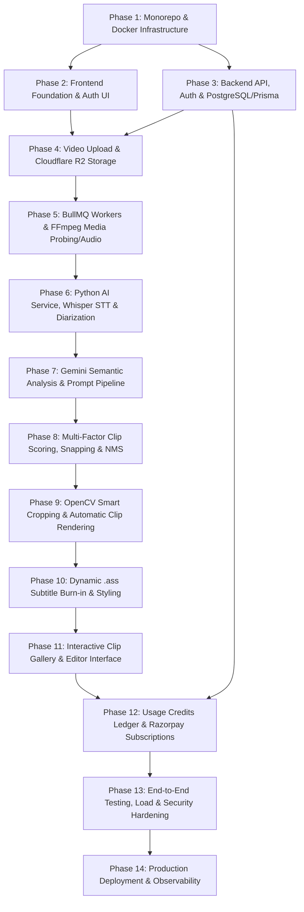

# Development Roadmap: ClipForge AI

| Document Metadata | Details |
| :--- | :--- |
| **Project Name** | ClipForge AI |
| **Delivery Methodology** | 14-Phase Dependency-Driven Incremental Rollout |
| **Scope Policy** | Strictly MVP features (`PRD.md` Section 7); zero premature V2/V3 bloat |

---

## Dependency Graph Overview

---

## Detailed Phase Breakdown

### Phase 1: Project Setup & Monorepo Configuration
- **Goals**: Establish a reproducible, type-safe polyglot monorepo and containerized local development environment.
- **Dependencies**: None (Starting point).
- **Tasks**:
  1. Initialize `pnpm-workspace.yaml`, root `package.json`, and `turbo.json`.
  2. Scaffold workspace directories: `apps/web`, `apps/api`, `apps/admin`, `services/ai-service`, `services/video-worker`, and `packages/{database,shared-types,validation,config,ui}`.
  3. Configure shared TypeScript (`tsconfig.base.json`), ESLint flat configs, and Prettier across all TS packages.
  4. Initialize Python `services/ai-service` with `pyproject.toml`, FastAPI skeleton, and `ruff`/`mypy`.
  5. Create `docker-compose.yml` provisioning PostgreSQL 16, Redis 7, and MinIO (local S3/R2-compatible object storage).
- **Expected Deliverables**: Running `pnpm install && docker compose up -d && pnpm dev` boots all services cleanly with health-check endpoints passing.
- **Completion Criteria**:
  - [ ] `GET http://localhost:4000/api/v1/health` (Node API) returns `200 OK`.
  - [ ] `GET http://localhost:8000/health` (Python AI Service) returns `200 OK`.
  - [ ] Shared types imported from `@clipforge/shared-types` compile in both `apps/web` and `apps/api`.

---

### Phase 2: Frontend Foundation & Authentication UI
- **Goals**: Build the Next.js 15 application shell, design system primitives (`packages/ui`), and authentication screens.
- **Dependencies**: Phase 1.
- **Tasks**:
  1. Configure Tailwind CSS + `shadcn/ui` components in `packages/ui` (`Button`, `Input`, `Card`, `Dialog`, `Badge`, `Progress`, `Toast`).
  2. Implement public marketing layout and auth pages (`/login`, `/register`, `/forgot-password`, `/verify-email`) using React Hook Form + `@clipforge/validation` Zod schemas.
  3. Build the protected `(dashboard)` sidebar layout, header credit badge, and Next.js route protection middleware (`middleware.ts`).
  4. Configure TanStack Query provider and Axios/Fetch client with automatic 401 token refresh interceptor.
- **Expected Deliverables**: Responsive frontend shell with complete auth forms and dashboard navigation.
- **Completion Criteria**:
  - [ ] Client-side Zod validation blocks invalid email/password inputs with accessible error states.
  - [ ] Unauthenticated requests to `/dashboard` redirect cleanly to `/login`.

---

### Phase 3: Backend APIs, Authentication & PostgreSQL Integration
- **Goals**: Implement the complete Prisma database schema, repository layer, and secure authentication/session lifecycle.
- **Dependencies**: Phase 1, Phase 2.
- **Tasks**:
  1. Author `packages/database/prisma/schema.prisma` (all 17 entities) and run initial migration (`prisma migrate dev`).
  2. Seed default subscription plan limits (`FREE`, `STARTER`, `PRO`, `BUSINESS`).
  3. Implement `auth.controller.ts` & `auth.service.ts`: Argon2id hashing, JWT access token signing, `Session` table refresh token rotation, email verification token generation, and password reset flow.
  4. Implement Redis-backed rate limiting (`rate-limit.middleware.ts`) and centralized error handling (`error.middleware.ts`).
  5. Connect `apps/web` auth forms to `/api/v1/auth/*` endpoints.
- **Expected Deliverables**: End-to-end registration, login, session refresh, logout, and `/api/v1/auth/me` profile hydration.
- **Completion Criteria**:
  - [ ] Registering a new user atomically creates `User`, `Subscription (FREE)`, and `UsageCredit (60 mins)`.
  - [ ] Token refresh rotates `Session.refreshTokenHash` and rejects reused tokens.

---

### Phase 4: Video Upload & Cloud Storage Ingestion
- **Goals**: Enable direct browser-to-R2/S3 multipart video uploads and SSRF-protected URL ingestion.
- **Dependencies**: Phase 3.
- **Tasks**:
  1. Implement `POST /api/v1/projects`, `GET /api/v1/projects`, `GET /api/v1/projects/:id`, and `DELETE /api/v1/projects/:id`.
  2. Implement `storage.service.ts` using `@aws-sdk/client-s3` and `@aws-sdk/s3-request-presigner` for multipart upload initiation, part signing, and completion.
  3. Implement `url-validator.service.ts` with DNS resolution checks blocking private/loopback/metadata IP ranges.
  4. Build `VideoDropzone` and `use-multipart-upload.ts` in `apps/web` with chunk upload concurrency (`4` parallel parts), live percentage bar, and mandatory `RightsAttestationCheckbox`.
- **Expected Deliverables**: Users can upload `.mp4`/`.mov` files up to tier limits directly to R2/MinIO and create `VideoProject` records.
- **Completion Criteria**:
  - [ ] A 500 MB MP4 uploads directly from browser to R2/MinIO without buffering in `apps/api` memory.
  - [ ] Attempting to ingest `http://127.0.0.1` or `http://169.254.169.254` returns `403 SSRF_BLOCKED_HOST`.

---

### Phase 5: BullMQ Job Orchestration & FFmpeg Media Extraction
- **Goals**: Build the asynchronous worker foundation, job progress tracking, media probing, and speech audio extraction.
- **Dependencies**: Phase 4.
- **Tasks**:
  1. Configure `project-analysis-queue` and `clip-render-queue` in `apps/api` and `services/video-worker`.
  2. Implement `POST /api/v1/projects/:id/process`, `GET /api/v1/jobs/:id`, and `POST /api/v1/jobs/:id/cancel`.
  3. Implement scratch disk manager (`/tmp/clipforge/jobs/{jobId}`) with `try/finally` cleanup guarantees.
  4. Implement `ffprobe.ts` (validating duration, resolution, FPS, and audio stream existence) and `audio-extractor.ts` (`16kHz` mono PCM WAV extraction + upload to R2).
  5. Build live job progress polling UI (`JobStatusPipeline`) in `apps/web`.
- **Expected Deliverables**: Triggering processing downloads the source video on the worker, probes metadata, extracts `16kHz` WAV audio, and updates live progress in the UI.
- **Completion Criteria**:
  - [ ] Video without an audio track fails gracefully with `NO_AUDIO_STREAM_DETECTED` and refunds held credits.
  - [ ] Cancelling an active job terminates the running `ffmpeg` child process and cleans up `/tmp/clipforge/jobs/{jobId}`.

---

### Phase 6: Whisper Transcription & Speaker Diarization
- **Goals**: Transcribe extracted audio with word-level timestamps and speaker turn labels.
- **Dependencies**: Phase 5.
- **Tasks**:
  1. Implement `POST /internal/v1/transcribe` in `services/ai-service`.
  2. Integrate `faster-whisper` with VAD filtering and `word_timestamps=True`.
  3. Integrate `pyannote.audio` speaker diarization and `aligner.py` to map speaker labels (`SPEAKER_00`, `SPEAKER_01`) onto words and utterances.
  4. Persist `Transcript`, `Speaker`, and `TranscriptSegment` records in PostgreSQL via `video-worker`.
- **Expected Deliverables**: Every processed project generates a complete, word-accurate, speaker-diarized transcript stored in PostgreSQL.
- **Completion Criteria**:
  - [ ] A 15-minute multi-speaker test video produces `TranscriptSegment` rows with accurate `wordsJson` arrays (`{ word, start, end, score, speaker }`).

---

### Phase 7: Gemini AI Semantic Content Analysis
- **Goals**: Analyze diarized transcripts using Google Gemini to detect hooks, humor, educational value, storytelling, and emotional peaks.
- **Dependencies**: Phase 6.
- **Tasks**:
  1. Implement `chunker.py` (30-minute sliding windows with 5-minute overlap snapped to speaker pauses).
  2. Implement `gemini_client.py` and `prompts.py` using `google-genai` SDK with `response_schema=GeminiClipAnalysisResponse`.
  3. Enforce Pydantic v2 validation (`clip_schema.py`) and Zod validation (`@clipforge/validation`) on all LLM responses.
  4. Implement retry with exponential backoff for transient rate limits (`429`/`503`).
- **Expected Deliverables**: Internal endpoint `POST /internal/v1/detect-clips` returning structured JSON candidate clips with categories, titles, descriptions, and selection reasons.
- **Completion Criteria**:
  - [ ] 100% of responses from `/internal/v1/detect-clips` pass strict Pydantic and Zod schema validation.

---

### Phase 8: Clip Selection, Multi-Factor Scoring & Boundary Optimization
- **Goals**: Score candidate clips transparently, snap boundaries to exact word timestamps, and eliminate overlapping duplicates.
- **Dependencies**: Phase 7.
- **Tasks**:
  1. Implement `clip_scorer.py` computing `hookScore`, `engagementScore`, `contextScore`, and composite `overallScore`.
  2. Implement `boundary_optimizer.py` snapping LLM start/end timestamps to Whisper sentence/word boundaries with `120ms` pre-roll and `200ms` post-roll buffers.
  3. Implement Temporal Non-Maximum Suppression (`IoU < 0.15`, overlap coefficient `< 0.30`) across sliding windows.
  4. Persist ranked `Clip`, `ClipScore`, and initial `ClipCaption` records in PostgreSQL.
- **Expected Deliverables**: Ranked, non-overlapping candidate clips persisted in PostgreSQL with full multi-factor score breakdowns.
- **Completion Criteria**:
  - [ ] Zero generated clips start or end mid-word, and no two clips in the same project have temporal `IoU >= 0.15`.

---

### Phase 9: OpenCV Smart Cropping & Automatic Clip Rendering
- **Goals**: Cut video segments, track active speakers for vertical (`9:16`) reframing, and generate MP4 clips + thumbnails.
- **Dependencies**: Phase 8.
- **Tasks**:
  1. Implement `POST /internal/v1/compute-crop` in `services/ai-service` using OpenCV shot boundary detection, MediaPipe face detection, and EMA + deadzone crop stabilization.
  2. Implement `smart-cropper.ts` in `services/video-worker` supporting `RATIO_9_16`, `RATIO_16_9`, and `RATIO_1_1` across `FACE_TRACK`, `CENTER_CROP`, and `BLUR_PAD` modes.
  3. Implement `thumbnail-generator.ts` selecting the sharpest face frame via Laplacian variance.
  4. Fan out parallel `SINGLE_CLIP_RENDER` jobs via BullMQ and upload rendered `.mp4` and `.jpg` files to R2.
- **Expected Deliverables**: Playable vertical (`9:16`), square (`1:1`), and horizontal (`16:9`) MP4 clips with smooth speaker framing and thumbnails.
- **Completion Criteria**:
  - [ ] Single-speaker horizontal videos are reframed to `1080x1920` keeping the speaker centered without camera jitter; screen-share segments automatically fall back to blurred background padding.

---

### Phase 10: Dynamic Subtitle Generation & Styling
- **Goals**: Burn word-accurate, customizable animated subtitles into rendered clips.
- **Dependencies**: Phase 9.
- **Tasks**:
  1. Implement `subtitle-generator.ts` converting `ClipCaption` JSON + style settings into `.ass` (Advanced SubStation Alpha) files with word-by-word active highlight tags.
  2. Bundle curated creator fonts (`Montserrat`, `Inter`, `TheBoldFont`) into the worker Docker image.
  3. Integrate `ass=...` filter into the single-pass FFmpeg encoding pipeline alongside watermark overlay logic for `FREE` tier users.
- **Expected Deliverables**: Rendered MP4 clips feature burned-in, word-highlighted subtitles positioned in vertical safe zones.
- **Completion Criteria**:
  - [ ] Subtitles sync within `±50ms` of spoken audio and respect safe-zone margins on YouTube Shorts / Reels / TikTok overlays.

---

### Phase 11: Clip Management & Lightweight Editing Interface
- **Goals**: Build the frontend Clip Gallery and Interactive Clip Editor for reviewing, filtering, editing subtitles/boundaries, and downloading clips.
- **Dependencies**: Phase 10.
- **Tasks**:
  1. Build Project Workspace (`/projects/[projectId]`) displaying the ranked Clip Gallery, `ScoreBreakdownBadge`, category filters, and sorting controls.
  2. Build Interactive Clip Editor (`/projects/[projectId]/clips/[clipId]`) with `VideoPlayer9x16`, synchronized transcript word editor, boundary trim handles, aspect ratio switcher, and subtitle style controls.
  3. Connect `PATCH /api/v1/clips/:id`, `POST /api/v1/clips/:id/regenerate`, and `GET /api/v1/exports/:id`.
- **Expected Deliverables**: Complete creator workflow from viewing AI scores to tweaking a subtitle word, re-rendering in <30s, and downloading the MP4.
- **Completion Criteria**:
  - [ ] Editing a word in the transcript and clicking "Regenerate" triggers `SINGLE_CLIP_RENDER` and updates the video player with the newly burned-in subtitle.

---

### Phase 12: Usage Credits Ledger & Razorpay Subscriptions
- **Goals**: Enforce subscription tier limits, atomic credit accounting, and Razorpay payment integration.
- **Dependencies**: Phase 3, Phase 11.
- **Tasks**:
  1. Implement `credit.service.ts` (`HOLD`, `COMMIT`, `REFUND`, and monthly `CYCLE_GRANT` cron).
  2. Implement `razorpay.provider.ts` (`POST /api/v1/billing/checkout` and `POST /api/v1/billing/webhooks/razorpay` with HMAC-SHA256 signature verification).
  3. Scaffold `stripe.provider.ts` implementing the same `IPaymentGateway` interface.
  4. Build `/billing` page in `apps/web` displaying plan comparison cards, Razorpay Checkout modal integration, credit usage ledger, and invoice history.
- **Expected Deliverables**: End-to-end subscription upgrades, webhook credit provisioning, and tier enforcement (watermark, resolution, max duration).
- **Completion Criteria**:
  - [ ] Simulated Razorpay `subscription.activated` webhook upgrades user to `PRO`, removes watermarks, enables `1080p`, and allocates `1,000` credits idempotently.

---

### Phase 13: Comprehensive Testing & Security Hardening
- **Goals**: Validate unit, integration, E2E, load, and security resilience across all services.
- **Dependencies**: Phase 12.
- **Tasks**:
  1. Execute unit and integration test suites across `apps/api` (Vitest + Supertest), `services/ai-service` (Pytest), and `services/video-worker` (`TESTING_STRATEGY.md`).
  2. Run Playwright E2E tests covering signup → upload → clip generation → subtitle edit → export.
  3. Run k6 load tests against API endpoints and concurrent BullMQ worker pipelines.
  4. Perform security audit: SSRF bypass tests, IDOR cross-tenant tests, malformed media container fuzzing, and `.ass` subtitle injection sanitization tests.
- **Expected Deliverables**: Automated CI test pipeline passing with `>80%` core business logic coverage and zero critical/high vulnerabilities.
- **Completion Criteria**:
  - [ ] All test suites in `TESTING_STRATEGY.md` pass deterministically in CI.

---

### Phase 14: Deployment & Production Optimization
- **Goals**: Deploy production infrastructure, configure autoscaling and storage lifecycles, and launch MVP.
- **Dependencies**: Phase 13.
- **Tasks**:
  1. Deploy `apps/web` and `apps/admin` to Vercel.
  2. Build and push production Docker images for `apps/api`, `services/ai-service`, and `services/video-worker`.
  3. Provision Managed PostgreSQL (with PgBouncer), Managed Redis, and Cloudflare R2 buckets (with CORS and lifecycle rules).
  4. Configure structured log aggregation, Sentry error tracking, and queue-depth alerts.
- **Expected Deliverables**: Live, monitored production SaaS environment ready for onboarding users.
- **Completion Criteria**:
  - [ ] Zero-downtime deployment verified; production smoke test processes a 30-minute 1080p video end-to-end in `< 6 minutes`.

