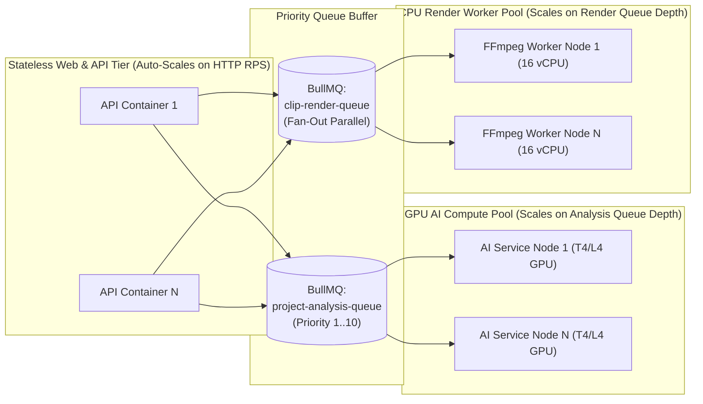

# Security & Scalability Architecture: ClipForge AI

| Document Metadata | Details |
| :--- | :--- |
| **Project Name** | ClipForge AI |
| **Document Version** | 1.0.0 |
| **Security Posture** | Defense-in-Depth, Zero-Trust Internal Service Auth, Strict Multi-Tenant Data Isolation |

---

## 1. Security Architecture

### 1.1 Authentication, Session Security & Password Hashing
- **Password Hashing**: Passwords are hashed using **Argon2id** (`memoryCost: 65536` (64 MB), `timeCost: 3`, `parallelism: 4`), resisting GPU/ASIC cracking attacks. Plaintext passwords are never logged and are truncated/rejected above 72 characters to prevent DoS hashing attacks.
- **Dual-Token Session Model**:
  - **Access Token**: Short-lived (`15 minutes`) stateless JWT signed with `HS256` (or `RS256`) containing `{ sub: userId, role, planTier }`, sent in the `Authorization: Bearer` header.
  - **Refresh Token**: `7-day` opaque/JWT token stored in an `HttpOnly`, `Secure`, `SameSite=Strict` cookie scoped exclusively to `Path=/api/v1/auth`.
  - **Token Rotation & Revocation**: Every refresh token is hashed (`SHA-256`) and stored in the PostgreSQL `Session` table. Using a refresh token rotates it immediately. If a previously rotated token is reused (indicating token theft), all sessions for that `userId` are immediately revoked (`UPDATE "Session" SET "revokedAt" = NOW() WHERE "userId" = $1`).

### 1.2 Authorization & Multi-Tenant Data Isolation
- **Strict Tenant Scoping**: Every repository query on `VideoProject`, `VideoAsset`, `ProcessingJob`, `Clip`, and `Export` explicitly filters by `userId` (or `project: { userId: req.user.id }`).
- **UUIDv4 / UUIDv7 Identifiers**: All public resource IDs are non-sequential UUIDs to prevent Insecure Direct Object Reference (IDOR) enumeration.
- **Internal Microservice Authentication**: `services/ai-service` is deployed inside a private Docker/VPC network and requires an `X-Internal-Service-Key` header verified via constant-time comparison (`hmac.compare_digest`). It is never exposed to the public internet.

### 1.3 Rate Limiting & Abuse Prevention
Implemented via Redis sliding-window counters (`rate-limiter-flexible`) in `apps/api/src/middlewares/rate-limit.middleware.ts`:
| Endpoint Group | Limit Window | Threshold | Identifier |
| :--- | :--- | :--- | :--- |
| `/api/v1/auth/login`, `/register` | 15 minutes | 5–10 requests | Client IP + Email |
| `/api/v1/auth/forgot-password` | 15 minutes | 3 requests | Client IP |
| `/api/v1/videos/upload/initiate` | 15 minutes | 10 requests | `userId` |
| `/api/v1/projects/:id/process` | 5 minutes | 5 requests | `userId` |
| `/api/v1/clips/:id/regenerate` | 5 minutes | 10 requests | `userId` |
| General Authenticated Reads (`GET`) | 1 minute | 120 requests | `userId` |

### 1.4 Upload Validation, File Size Restrictions & Media Sanitization
1. **Pre-Flight Size Enforcement**: When calling `/api/v1/videos/upload/initiate`, the S3/R2 Presigned Multipart Upload enforces exact `Content-Type` and tier-specific byte limits (`500 MB` Free, `2 GB` Starter, `5 GB` Pro, `10 GB` Business).
2. **Magic-Byte & Container Verification**: Before `video-worker` runs full FFmpeg processing, it inspects the first `4096` bytes (`file-type` magic bytes check) to verify the file is a genuine ISO Base Media File Format (`ftyp` box for MP4/MOV) or Matroska/WebM container, rejecting disguised executables or scripts.
3. **FFmpeg Protocol Whitelisting (Malware / Exploit Mitigation)**: Maliciously crafted HLS/M3U8 playlists or AVI/MOV reference files can attempt local file inclusion (`file://`) or SSRF inside FFmpeg. Every `ffprobe` and `ffmpeg` command runs under an unprivileged non-root Linux user (`clipforge-worker`) with explicit protocol and demuxer whitelisting:
   ```bash
   ffprobe -protocol_whitelist file -allowed_extensions mp4,mov,m4v,webm -i source.mp4
   ```

### 1.5 SSRF (Server-Side Request Forgery) Protection for URL Ingestion
When a user submits a direct media URL via `POST /api/v1/videos/url`:
1. Only `https://` scheme on port `443` is permitted.
2. Custom DNS resolver resolves the hostname prior to connecting and blocks all private, loopback, link-local, and cloud metadata IP ranges:
   - `127.0.0.0/8`, `10.0.0.0/8`, `172.16.0.0/12`, `192.168.0.0/16`
   - `169.254.0.0/16` (AWS/Cloud metadata service `169.254.169.254`)
   - `::1/128`, `fc00::/7`, `fe80::/10`
3. HTTP redirects are either disabled or re-validated through the exact same DNS/IP filter on every hop (max 3 hops).
4. Response stream is aborted immediately if `Content-Type` does not match `video/*` or `application/octet-stream` or if streamed bytes exceed the user's tier limit.

### 1.6 Signed Object Storage URLs
- Cloudflare R2 / S3 buckets are configured as **100% Private** (no public bucket listing or unauthenticated public reads).
- Upload URLs (`PutObject` / `UploadPart`) expire in **15 minutes** and are locked to the specific `storageKey` (`users/{userId}/projects/{projectId}/source.mp4`).
- Playback and download URLs (`GetObject`) are signed with a **15-minute TTL**.

### 1.7 Environment Secrets, CORS, CSRF, SQLi & XSS Prevention
- **Environment Secrets**: Validated at boot using Zod (`apps/api/src/config/env.ts`) and Pydantic `BaseSettings` (`services/ai-service/app/core/config.py`). If any required secret (`JWT_ACCESS_SECRET`, `GEMINI_API_KEY`, `R2_SECRET_ACCESS_KEY`, `RAZORPAY_WEBHOOK_SECRET`) is missing, the process fails fast on startup. API keys are never exposed to `NEXT_PUBLIC_*` frontend variables.
- **CORS**: Strictly locked to `FRONTEND_URL` and `ADMIN_URL` with `credentials: true`.
- **CSRF**: State-mutating API endpoints require `Authorization: Bearer <accessToken>` custom header (which browsers never send automatically cross-origin), and the `/auth/refresh` cookie uses `SameSite=Strict`.
- **SQL Injection**: Prevented via parameterized queries in Prisma ORM; raw SQL queries (`$queryRaw`) use tagged template literals exclusively.
- **XSS Prevention**: React escapes rendered strings by default; `Helmet` sets strict `Content-Security-Policy` headers on the API; user-edited subtitle text is sanitized to strip `.ass` control override injection characters (`{`, `}`, `\`) before writing `.ass` files.

### 1.8 Copyright & Content Authorization Policy
- **Mandatory Attestation**: Users cannot create a project or ingest a URL without setting `rightsAttested: true`, recorded with timestamp and IP audit trail.
- **No Unauthorized Third-Party Scraping**: The system architecture explicitly excludes unauthorized third-party platform scrapers (`yt-dlp` crackers or DRM bypass tools). Only user-uploaded files and authorized direct media URLs are ingested.

---

## 2. Scalability Architecture (Supporting 100s to 10,000s of Users)

### 2.1 Bottleneck Identification & Decoupling
In a video AI SaaS, compute resources scale asymmetrically:
- **Web & REST API (`apps/web`, `apps/api`)**: I/O-bound, sub-10ms CPU time per request. A single 2-vCPU container handles 500+ req/sec.
- **AI Transcription & Diarization (`services/ai-service`)**: GPU-bound (`faster-whisper` + `pyannote.audio`).
- **Video Cropping & Subtitle Encoding (`services/video-worker`)**: CPU-bound (`FFmpeg libx264` + `libass`).

By decoupling these tiers via **Redis + BullMQ** and **Cloudflare R2**, each tier scales independently without affecting API responsiveness.



### 2.2 Parallel Fan-Out Rendering (`FlowProducer`)
When Gemini identifies 12 clips in a 60-minute video, rendering all 12 clips sequentially on one worker would take ~2–3 minutes. Instead, `project-analysis.processor.ts` fans out 12 independent `SINGLE_CLIP_RENDER` jobs into `clip-render-queue`. Across a pool of 4 render workers (each running 3 concurrent FFmpeg encodes), all 12 clips render simultaneously in **< 20 seconds**.

### 2.3 Worker Resource Limits & Concurrency Controls
- **FFmpeg Thread Pinning**: Each FFmpeg subprocess is explicitly bounded with `-threads 4` so a single render job cannot starve the Node.js event loop or cause BullMQ lock renewal timeouts (`stalledInterval: 30000ms`, `lockDuration: 120000ms`).
- **Subprocess Timeout Watchdog**: Every FFmpeg execution has a hard timeout (`max(180s, clipDuration * 4)`). Hung processes receive `SIGKILL`.
- **Per-User Concurrency Quotas**: Free users can run at most `1` concurrent project analysis job; Pro/Business users can run up to `3–5` concurrent jobs, enforced via Redis counters and BullMQ priorities (`Business=1`, `Pro=2`, `Starter=5`, `Free=10`).

### 2.4 Database & Storage Scaling Path (100 → 10,000+ Users)
1. **Connection Pooling**: Use **PgBouncer** (or Supabase/Neon built-in connection pooler) in transaction mode so 50+ horizontally scaled worker containers do not exhaust PostgreSQL `max_connections`.
2. **Table Partitioning (At 1M+ Clips / 50M+ Segments)**: Partition `TranscriptSegment` and `UsageHistory` by monthly range or hash when table sizes exceed 50 GB.
3. **Zero-Egress CDN Delivery**: Serve rendered `.mp4` clips and `.jpg` thumbnails through Cloudflare CDN backed by R2 custom domains with signed cookies/tokens, delivering sub-50ms video startup latency globally with zero bandwidth egress cost.

