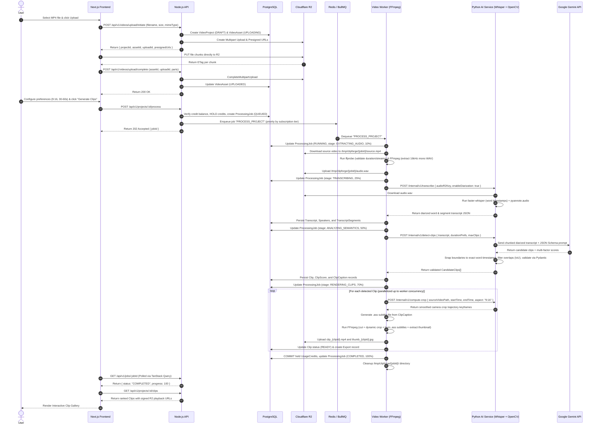

# System Architecture Document: ClipForge AI

| Document Metadata | Details |
| :--- | :--- |
| **Project Name** | ClipForge AI |
| **Document Version** | 1.0.0 |
| **Status** | Approved Architecture Specification |

---

## 1. High-Level System Architecture

ClipForge AI uses an **Event-Driven, Queue-Orchestrated Microservice Architecture**. Synchronous HTTP requests handle user authentication, project management, metadata queries, and upload orchestration. All compute-heavy operations (media probing, audio extraction, speech-to-text, LLM semantic analysis, face tracking, and video rendering) execute asynchronously via **Redis + BullMQ** background worker pipelines.

```mermaid
flowchart TB
    subgraph ClientLayer["Client Layer (Browser)"]
        WebApp["Next.js 15 Frontend (apps/web)"]
        AdminApp["Admin Portal (apps/admin)"]
    end

    subgraph ControlPlane["Control Plane (Application Backend)"]
        APIGateway["Nginx / Cloudflare Reverse Proxy"]
        NodeAPI["Node.js + Express REST API (apps/api)"]
    end

    subgraph DataLayer["State & Persistence Layer"]
        Postgres[("PostgreSQL 16\n(Prisma ORM)")]
        Redis[("Redis 7\n(BullMQ Queues & Cache)")]
        ObjectStorage[("Cloudflare R2 / AWS S3\n(Object Storage)")]
    end

    subgraph ComputePlane["Asynchronous Media & AI Compute Plane"]
        VideoWorker["Video Processing Worker\n(services/video-worker)\nBullMQ Consumer + FFmpeg 7"]
        AIService["Python FastAPI AI Service\n(services/ai-service)"]
        WhisperEngine["faster-whisper + pyannote.audio\n(STT & Speaker Diarization)"]
        VisionEngine["OpenCV + MediaPipe\n(Face & Scene Detection)"]
    end

    subgraph ExternalAPIs["External Third-Party Services"]
        GeminiAPI["Google Gemini API\n(Semantic Analysis & Clip Scoring)"]
        RazorpayAPI["Razorpay / Stripe\n(Payments & Webhooks)"]
    end

    WebApp -->|HTTPS REST + JWT| APIGateway
    AdminApp -->|HTTPS REST + JWT| APIGateway
    APIGateway --> NodeAPI

    WebApp -->|1. Direct Multipart Upload\n(Presigned PUT)| ObjectStorage
    WebApp <--|2. Stream / Download Clips\n(Presigned GET / CDN)| ObjectStorage

    NodeAPI -->|Read / Write Entities| Postgres
    NodeAPI -->|Enqueue Jobs & Read Progress| Redis
    NodeAPI -->|Generate Presigned URLs| ObjectStorage
    RazorpayAPI -->|Signed Webhooks| NodeAPI

    Redis <-->|Consume Jobs / Emit Progress| VideoWorker
    VideoWorker <-->|Download Source / Upload Clips & WAV| ObjectStorage
    VideoWorker -->|Update Job & Clip Status| Postgres
    VideoWorker -->|Internal HTTP REST (x-internal-token)| AIService

    AIService --> WhisperEngine
    AIService --> VisionEngine
    AIService <-->|Download Audio/Video Stream| ObjectStorage
    AIService -->|Structured JSON Prompting| GeminiAPI
```

---

## 2. Inter-Service Communication Matrix

Below is the exact communication contract between the 10 core architectural components:

| Source Component | Target Component | Protocol / Mechanism | Authentication | Payload / Purpose |
| :--- | :--- | :--- | :--- | :--- |
| **1. Next.js Frontend** | **2. Node.js API Server** | HTTPS REST (`JSON`) | `Authorization: Bearer <JWT>` + HTTP-only Refresh Cookie | Auth, project creation, upload initiation, job status polling, clip edits. |
| **1. Next.js Frontend** | **10. Object Storage (R2/S3)** | HTTPS `PUT` / `GET` | Presigned S3 URLs (`X-Amz-Signature`, TTL 15m) | Direct browser-to-R2 multipart video upload and rendered MP4 clip playback/download. |
| **2. Node.js API Server** | **3. PostgreSQL Database** | TCP (`pg` protocol via Prisma) | TLS + Connection String Credentials | Transactional CRUD for users, credits, projects, transcripts, clips, and billing. |
| **2. Node.js API Server** | **4. Redis & 5. BullMQ** | TCP (`RESP3` via `ioredis`) | TLS + Redis Password | Enqueue jobs into `video-processing` and `clip-rendering` queues; read live progress hashes. |
| **5. BullMQ Queues** | **7. FFmpeg Video Worker** | TCP (`ioredis` blocking pop / Lua scripts) | TLS + Redis Password | Dispatch queued jobs (`PROCESS_PROJECT`, `RENDER_CLIP`) with priority ordering. |
| **7. FFmpeg Video Worker** | **10. Object Storage (R2/S3)** | HTTPS S3 SDK (`@aws-sdk/client-s3`) | IAM Access Key + Secret Key | Stream raw video to local NVMe scratch disk; upload extracted `16kHz` WAV, rendered `.mp4` clips, and `.jpg` thumbnails. |
| **7. FFmpeg Video Worker** | **6. Python AI Service** | Internal HTTP/1.1 or HTTP/2 (`JSON`) | `X-Internal-Service-Key` Shared Secret | Trigger `/internal/v1/transcribe`, `/internal/v1/analyze-semantics`, and `/internal/v1/track-speakers`. |
| **6. Python AI Service** | **9. Whisper Engine** | In-process Python / CUDA Worker Pool | N/A (Internal Module) | Run `faster-whisper` and `pyannote.audio` on the extracted `16kHz` WAV file. |
| **6. Python AI Service** | **8. Gemini API** | HTTPS REST / gRPC (`google-genai` SDK) | `GEMINI_API_KEY` | Send windowed diarized transcripts + system instructions; receive structured JSON clip candidates and scores. |
| **7. FFmpeg Video Worker** | **3. PostgreSQL Database** | TCP (Prisma Client) | TLS + Connection String Credentials | Persist transcript segments, candidate clips, clip scores, and final export asset records. |

---

## 3. End-to-End Request & Processing Lifecycle

The sequence diagram below traces a video project from user upload to final clip playback:



---

## 4. Asynchronous Job Orchestration & Resilience

### 4.1 Queue Architecture (`BullMQ`)
We divide background processing into three dedicated BullMQ queues so fast clip re-renders are never blocked behind 2-hour video transcriptions:
1. **`project-analysis-queue`**: Handles Step 1 through Step 11 (Ingestion validation, Audio Extraction, Whisper STT, Gemini Semantic Analysis, and Clip Candidate Persistence).
2. **`clip-render-queue`**: Handles Step 12 through Step 15 (OpenCV face-crop calculation, `.ass` subtitle generation, FFmpeg encoding, thumbnail extraction, and R2 upload) for individual clips. A single project spawns `N` child jobs in `clip-render-queue` managed via BullMQ `FlowProducer`.
3. **`maintenance-cleanup-queue`**: Scheduled cron jobs (`0 * * * *`) that clean up abandoned multipart uploads, expired projects based on tier retention, and orphaned scratch directories.

### 4.2 Job Retries & Backoff Strategy
Transient failures (e.g., Gemini API `429 Too Many Requests` or `503 Service Unavailable`, temporary R2 network blips) are handled automatically:
- **Max Attempts**: `3` attempts per job stage.
- **Backoff Strategy**: Exponential backoff starting at `5,000ms` (`5s`, `25s`, `125s`) with random jitter (`±20%`).
- **Non-Retryable Errors (`UnrecoverableError`)**: If a video file is corrupted, contains no audio stream, exceeds tier duration limits, or violates safety policies, the worker throws BullMQ's `UnrecoverableError` to bypass retries and immediately transition the job to `FAILED`.

### 4.3 Failed Jobs & Dead-Letter Handling (DLQ)
When a job exhausts all 3 retry attempts or throws `UnrecoverableError`:
1. The worker catches the terminal failure in the `failed` event hook.
2. Within a single Prisma database transaction:
   - `ProcessingJob.status` is set to `FAILED` with a user-friendly `errorMessage` and an internal `errorCode` + stack trace for admins.
   - `VideoProject.status` is set to `FAILED`.
   - Any `HELD` credits for that job in `UsageHistory` are automatically reversed (`REFUNDED`) back to the user's `UsageCredit.balance`.
3. Failed jobs are retained in Redis `failed` set (up to 1,000 jobs or 14 days) for inspection and one-click replay in the Admin Portal (`apps/admin`).

### 4.4 Job Cancellation
Users can cancel an in-flight job via `POST /api/v1/jobs/:id/cancel`:
1. The API sets a cancellation flag in Redis (`SET job:cancel:{jobId} 1 EX 3600`) and updates `ProcessingJob.status = CANCELLING`.
2. If the job is still `WAITING` in BullMQ, `job.remove()` removes it immediately and refunds held credits.
3. If the job is `ACTIVE` on a worker, the worker checks `job:cancel:{jobId}` between pipeline stages and passes an `AbortSignal` to active child `ffmpeg` processes (`SIGTERM` followed by `SIGKILL` after 3s) and HTTP requests to `ai-service`.
4. Once terminated, temporary files are wiped and held credits are refunded if the job was cancelled prior to AI analysis completion.

### 4.5 Granular Progress Tracking
- Workers report both a numeric percentage (`0–100`) and a semantic stage enum (`VALIDATING_SOURCE`, `EXTRACTING_AUDIO`, `TRANSCRIBING`, `DIARIZING_SPEAKERS`, `ANALYZING_SEMANTICS`, `SCORING_CLIPS`, `RENDERING_CLIPS`, `UPLOADING_EXPORTS`, `COMPLETED`).
- Progress updates are written to Redis (`HSET job:progress:{jobId}`) on every sub-step and flushed to PostgreSQL `ProcessingJob` on major stage transitions.
- The frontend polls `GET /api/v1/jobs/:id` every `3,000ms` while a job is active (with automatic stop once `status` reaches `COMPLETED`, `FAILED`, or `CANCELLED`).

### 4.6 Idempotency & Duplicate Job Prevention
1. **Idempotency Keys**: `POST /api/v1/projects/:id/process` accepts an `Idempotency-Key` header and enforces a partial unique index in PostgreSQL ensuring a `VideoProject` can only have **one** active (`QUEUED` or `RUNNING`) `ProcessingJob` at a time.
2. **Deterministic BullMQ Job IDs**: Jobs are enqueued with deterministic IDs (`project-process-${projectId}`), preventing duplicate queue entries on rapid double-clicks.
3. **Checkpoint Resumption**: Before executing an expensive stage (such as Whisper transcription or Gemini analysis), the worker checks PostgreSQL to see if a valid `Transcript` or `Clip` set already exists for `projectId` from a previous attempt that failed at a later stage. If present, it skips the completed stage and resumes from the failed step.

### 4.7 Worker Scaling Strategy
- **Stateless Horizontal Scaling**: Both `services/video-worker` and `services/ai-service` are stateless across jobs.
- **Concurrency Tuning**:
  - Each `video-worker` container sets `BULLMQ_RENDER_CONCURRENCY` based on available vCPUs (e.g., on an 8-vCPU node, run 2 concurrent FFmpeg encodes with `-threads 4` each to prevent CPU thrashing).
  - Auto-scaling rules monitor Redis queue depth (`bull:project-analysis-queue:wait` and `bull:clip-render-queue:wait`). When queue wait time exceeds `120 seconds`, additional worker containers spin up automatically.

### 4.8 Cleanup of Temporary Files
Video processing generates large intermediate files (`source.mp4`, `audio.wav`, `.ass` subtitles, raw clip segments). To prevent worker disk exhaustion (`ENOSPC`):
1. **Isolated Job Scratch Directory**: Every job writes exclusively to `/tmp/clipforge/jobs/{jobId}/`.
2. **`try / finally` Guarantee**: The worker's main execution handler wraps the entire pipeline in a `try { ... } finally { await fs.rm(jobScratchDir, { recursive: true, force: true }); }` block so scratch files are deleted whether the job succeeds, fails, or is cancelled.
3. **Orphan Sweeper Daemon**: A background cron inside `video-worker` runs every 30 minutes and deletes any `/tmp/clipforge/jobs/{jobId}` directory whose modification timestamp (`mtime`) is older than `4 hours`.

